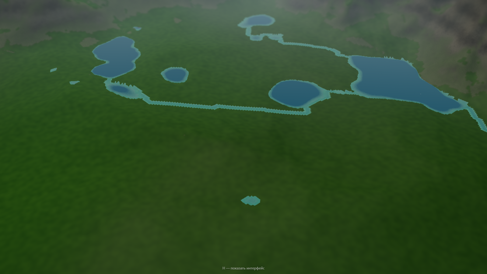
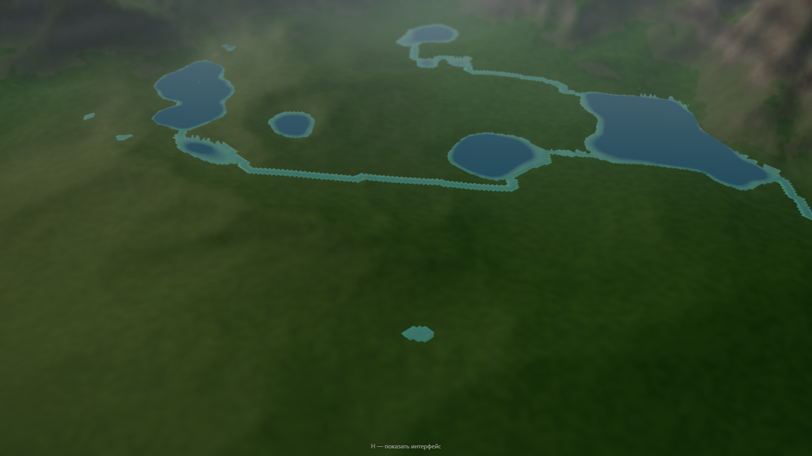
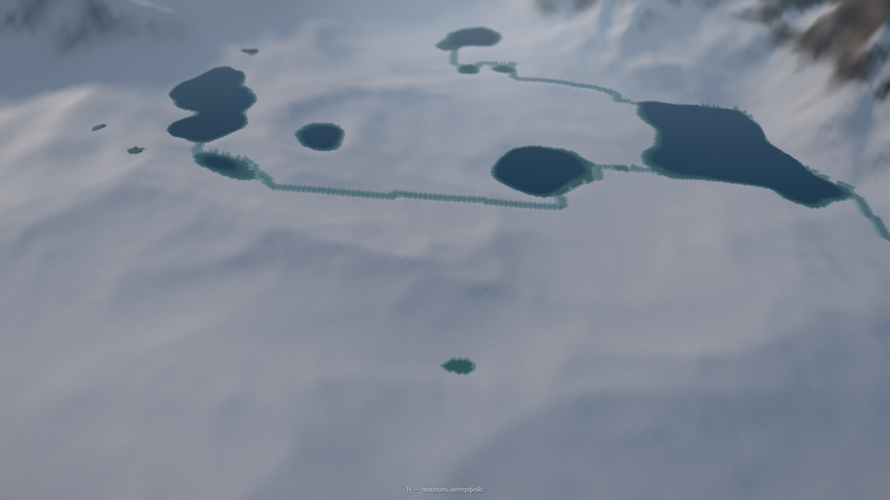

# Отчёт по фазе 2 — мир и среда

Дата: 2026-11-16 · Оборудование: эталон A — Intel Core i5-1235U, Intel Iris Xe, 8 ГБ, Windows 11, Edge и Chrome ([TARGET_HARDWARE.md](TARGET_HARDWARE.md))

Цель фазы (`DEVELOPMENT_PLAN.md`): большой красивый мир, созданный из seed, по которому можно летать и в котором идёт время. Фаза выполнена; работа остановлена до оценки заказчика, фаза 3 не начата.

## Как посмотреть

```bash
npm install
npm run dev
```

Открыть <http://127.0.0.1:5173> → «Новый мир» → выбрать seed, размер, климат, длину сезона → «Создать мир». Управление — в `README.md`. Быстрый старт без меню: `http://127.0.0.1:5173/?autostart=1&seed=42&size=M`.

## Итог по критериям выхода

| Критерий (`DEVELOPMENT_PLAN.md`) | Результат | Основание |
|---|---|---|
| Один seed даёт побитно одинаковый мир (тест по хешу, в двух браузерах) | **Выполнен**: хеш статики мира `267530a6fcb45b57` (seed 42, мир S) и хеш полного состояния совпали в Node, Edge 157 и Chrome 157. Оговорка: оба браузера на Chromium; Firefox на машине нет | `tests/e2e/smoke.spec.ts`, `docs/measurements/phase2-determinism-*.json` |
| В мире M видны реки, впадающие в озёра и море; условия различаются между провинциями | **Выполнен** на трёх seed: всё суша стекает в море без циклов, есть реки в озёра и в море; разброс средних температур провинций > 2 °C, осадков > 150 мм, высот > 100 м; ≥ 3 типа местности | `tests/sim/worldgen.test.ts`, скриншоты ниже |
| Смена сезонов меняет снег, температуру и влагу в данных и на экране | **Выполнен**: в данных — тест года; на экране — снимки одного вида летом, осенью и зимой и слои температуры и снега | `tests/sim/env.test.ts`, `tests/headed/seasons.spec.ts`, раздел 6 |
| Облёт мира на Iris Xe, средний пресет, WebGPU: ≥ 35 к/с без зависаний (решение заказчика №15) | **Выполнен**: 60 к/с (упор в вертикальную синхронизацию) на WebGPU и на WebGL 2, длинных кадров 0, симуляция 80 из 80 тактов/с на ×8 | `tests/headed/world-flyover.spec.ts`, раздел 5 |
| Сохранение → загрузка → хеш состояния совпадает | **Выполнен** в Node и в браузере (Edge, Chrome): через меню «сохранить → выйти → открыть» | `tests/unit/persistence.test.ts`, `tests/e2e/smoke.spec.ts` |

## 1. Что сделано по составу фазы

| Пункт плана | Состояние |
|---|---|
| Рельеф, эрозия | Каркас из детерминированного шума, хребты по краям, потоковая эрозия по дереву стока |
| Гидрология: озёра, реки, море | Priority-flood от моря; озёра в впадинах и ледниковых котловинах на водотоках; реки по порогу расхода, крупные — шире ячейки; русла прорезаны в рельеф 2 м |
| Базовый климат | Широтный и высотный градиенты, смягчение у моря, осадки от ветра с моря с орографией и дождевой тенью; три пресета климата |
| Почвы, залежи | 6 типов почв из каталога `content/soils/soils.json`; залежи камня, глины, руды, песка |
| Провинции с названиями | В проверенных мирах M — 25–43, S — около 10; границы по водоразделам и крупным рекам; названия по типу местности («Белское приозерье», «Иверские горы») |
| Поля среды: температура, влага почвы, снег, свет | Температура и свет вычисляются; влага, снег, расход, индекс зелени — состояние с часовым шагом |
| Время: сутки, сезоны, календарь | Длина сезона — настройка мира (3, 5, 8 суток); мир начинается в середине весны, 7:00 |
| Погода: дождь, снег, ветер | Погодные ячейки с дрейфом по ветру и регулятором климатической нормы; дождь или снег по температуре; переменчивый ветер |
| Рендер: чанки террейна с LOD | Квадродерево 64 м – 4 км, «юбки» против щелей, постепенное построение узлов |
| Материал по полям симуляции | Почва, зелень, влага, снег, недавние осадки, тень облаков, слои-карты |
| Естественные границы | Море до горизонта с прибоем; горы продолжаются за краем полосой горизонта 3–3,7 км; дымка. Среза и подставки нет |
| Вода: реки, озёра, водопады | Реки и озёра — по уровням из гидрологии; на крутых участках — пена перекатов. **Отдельной геометрии водопадов нет** (раздел 7) |
| Небо, солнце и луна, тени, туман | Перенесены из прототипа 1A; солнце по общей модели с симуляцией (длина дня по сезону); облачность из погоды |
| Сезонная цветокоррекция, частицы осадков | Есть; частицы — у земли (ниже 250 м), сверху погода видна по тени облаков |
| Камеры: стратегическая и свободная, плавный переход, режим без интерфейса | Есть; колесо в стратегической камере плавно делает взгляд положе у земли; Tab, H |
| UI: главное меню, создание мира, панель времени, мини-карта, карточка ячейки, слои | Есть; 7 слоёв: высота, влага почвы, температура, осадки (норма), снег, почвы, провинции |
| Сохранения v1: секционный формат, манифест, автосохранение, список миров | Есть — `docs/SAVE_FORMAT.md` |

## 2. Генерация мира

| Мир | Размер | Ячеек 8 м | Отсчётов высоты 2 м | Время генерации (Node) |
|---|---|---|---|---|
| S | 2 × 2 км | 256² | 1025² | 0,7 с |
| M | 4 × 4 км | 512² | 2049² | 2,5 с |

Мир генерируется заново и при загрузке сохранения (статика не хранится в файлах), поэтому скорость генерации важна для открытия мира.

Примеры: `docs/screenshots/phase2/flyover-webgpu-medium-*.png` (облёт), `layer-provinces-*.png` (провинции).

## 3. Среда во времени

Прогон года малого мира в Node (`tests/sim/env.test.ts`, умеренный климат, сезон 5 суток):

- лето теплее зимы, зимой снег лежит на большей части суши, летом снега нет;
- влага почвы и индекс зелени меняются по сезонам;
- годовая сумма осадков по суше — в пределах ±20 % климатической нормы (регулятор погоды);
- баланс воды сходится с относительной погрешностью < 10⁻⁴: изменение запасов = осадки − испарение − сток, весь сток доходит до моря;
- реки несут воду; расход в устьях соизмерим с многолетним;
- при сезоне 3 суток зима наступает раньше, чем при сезоне 8 (настройка мира работает).

**Камера и запросы не влияют на мир**: симуляция, у которой каждые 37 тактов запрашивали карточки, слои и поверхность, пришла к тому же хешу состояния, что и симуляция без наблюдения. Камера в симуляцию вообще не передаётся.

Стоимость (Node, мир M, без агентов): игровые сутки — 0,78 с; средний такт 0,11 мс; часовой шаг воды — 31 мс (до 63 мс), погода — 0,23 мс.

## 4. Сохранения

- Мир M занимает около 4–5 МБ: динамика среды; статика воспроизводится генератором и сверяется по хешу.
- Атомарная запись поколений: тест с обрезанной секцией нового поколения загружает предыдущее.
- Автосохранение раз в 2 минуты, при сворачивании вкладки, при выходе в меню.
- Подробности — `docs/SAVE_FORMAT.md`.

## 5. Производительность на Intel Iris Xe

Облёт мира M по маршруту «обзор → побережье → долина низко → горы → у реки в свободной камере → обзор», 5 участков по 8 с, обычное видимое окно Edge 1600 × 900, вертикальная синхронизация включена, симуляция на ×8 (80 тактов/с). Данные: `docs/measurements/phase2-flyover-*.json`.

| Пресет | Отрисовка | WebGPU | WebGL 2 | Длинных кадров (> 100 мс) |
|---|---|---|---|---|
| Низкий | 960 × 540 | 60 к/с | 60 к/с | 0 |
| **Средний** | 1200 × 675 | **60 к/с** (худший участок 59,9) | **60 к/с** | 0 |
| Высокий | 1600 × 900 | 45 к/с (худший участок 43) | 53 к/с (худший участок 48) | 0 |

На среднем пресете в кадре до 232 узлов рельефа, до 0,66 млн треугольников и 184 вызовов отрисовки. Такты симуляции не теряются ни на одном пресете.

Что убрали по ходу замеров:

- одиночные кадры 100–170 мс при первом снижении к земле — компиляция шейдера осадков и второго конвейера постобработки в момент первого использования; теперь оба компилируются при загрузке мира;
- ошибка квадродерева, из-за которой при малом бюджете построения рисовался только корневой узел; промежуточный замер с этой ошибкой отброшен;
- угловатые тени от далёких грубых узлов при низком зимнем солнце — тени теперь отбрасывают только узлы не крупнее 256 м; конвейер теней прогревается при загрузке.

60 к/с на среднем пресете — запас относительно допустимых 35–45: он понадобится под растительность фазы 3 (по фазе 1: 0,5–1,0 млн треугольников комфортно, деревья и трава добавят основную нагрузку).

## 6. Сезоны на экране

Мир M, seed 42, холодный климат, сезон 3 суток, один и тот же вид в середине лета, осени и зимы (`tests/headed/seasons.spec.ts`):

| | Лето | Осень | Зима |
|---|---|---|---|
| Снимок |  |  |  |
| Температура в ячейке, полдень | 14,4 °C | 5,9 °C | −9,0 °C |
| Снег | нет | нет | 38 см (126 мм воды) |
| Влага почвы | 92 % | 99 % | 72 % |
| Индекс зелени | 70 % | 78 % | 20 % |

Норма ячейки: год 1 °C, лето 13 °C, зима −11 °C. Слои температуры, снега и влаги для каждого сезона — `docs/screenshots/phase2/season-*-layer-*.png`; данные карточки — `docs/measurements/phase2-seasons-cards.json`. Зелень осенью ещё высока: покров откликается на сезонную норму тепла с запаздыванием, а не на суточную температуру; желтеет к концу осени. Лёд на озёрах не моделируется (раздел 7).

## 7. Ограничения и что сделано не так, как в плане

| Ограничение | Почему | Когда решать |
|---|---|---|
| Нет растительности; цвет покрова — индекс зелени, вычисленный из тепла, влаги и плодородия | Флора — фаза 3; рисовать траву и деревья без данных под ними запрещено принципом «одна истина на величину» | Фаза 3 |
| Нет отдельной геометрии водопадов: на крутых участках рек — пена перекатов | Водопад из прототипа 1A был поставлен вручную; в процедурном мире нужно выделять уступы русла | По решению заказчика — в фазе 3 или позже |
| Расход рек считается мгновенно по всему бассейну | Достаточно для сезонов; задержка добегания нужна для паводков | Фаза 5 |
| Уровень озёр постоянный (уровень перелива) | Колебания уровня — следующий шаг гидрологии | Фаза 3 или 5 |
| Погодные ячейки дрейфуют медленнее реального ветра (160 м за 10 игровых минут) | Сутки сжаты в 120 раз; реальная скорость прогоняла бы грозу через мир за секунды | Плейтест шкалы времени |
| Часовой шаг воды мира M — 31 мс в одном такте | На живую игру не влияет (воркер, 0,11 мс в среднем), но год среды ≈ 15 с — дольше цели догоняния «год за 10 с» | До фазы 4 (догоняние) |
| Статика мира не хранится: изменение генератора делает старые миры неоткрываемыми | Сохранения в 8–10 раз меньше | Заморозить генератор до v0.1 или хранить статику — решение заказчика |
| Лёд на озёрах и реках не моделируется: зимой вода открыта |  Нужна температура воды и баланс тепла водоёма | Фаза 5 (заморозки) |
| Далёкие горы не отбрасывают тени (узлы крупнее 256 м) | Иначе при низком солнце появлялись угловатые тени | При переходе на каскадные тени |
| Полоса горизонта за краем — 32 м на ячейку, без эрозии | Это фон в дымке; камера не уходит за границу мира | По необходимости |
| Высокий пресет — без MSAA | Пересоздание рендера при смене пресета; замеры фазы 1 показали низкую отдачу на Iris Xe | При появлении машины с дискретной картой |
| Детерминизм проверен в Edge и Chrome (оба Chromium) | Firefox на эталонной машине не установлен | При появлении второго движка |

Пул рабочих воркеров (архитектура, раздел 4) не заведён: генерация идёт в воркере симуляции, который в этот момент свободен. Список миров читается из манифестов OPFS без IndexedDB. Изменения внесены в `ARCHITECTURE.md`, раздел 8.17 (версия 1.2).

## 8. Тесты

| Набор | Количество | Что проверяет |
|---|---|---|
| `tests/sim/worldgen.test.ts` | 27 | Воспроизводимость, эталонный хеш, границы и горизонт, реки → озёра → море, уровни воды, провинции, почвы, климат — на трёх seed мира M |
| `tests/sim/env.test.ts` | 10 | Сезоны, норма осадков, баланс воды, расход рек, длина сезона, невлияние наблюдения, карточка |
| `tests/unit/persistence.test.ts` | 7 | Секции, CRC, сохранить → загрузить → ход одинаков, поколения, сбой записи, недопустимые идентификаторы |
| `tests/e2e/smoke.spec.ts` | 8 | WebGPU и WebGL 2: запуск, время и скорости, слои, карточка, камера, скрытие интерфейса; меню и сохранения; детерминизм браузер = Node |
| `tests/headed/world-flyover.spec.ts`, `seasons.spec.ts` | 2 | Облёт и сезоны в видимом окне |

Всего в `npm run verify`: 91 тест (было 48).

## 9. Решения, которые нужны от заказчика

1. Оценка фазы 2 и разрешение перехода к фазе 3 «Флора и инструменты создателя».
2. Шкала времени: длина сезона по умолчанию (сейчас 5 суток; при создании мира — 3, 5 или 8).
3. Хранить ли статику мира в сохранении (надёжнее при обновлениях генератора, ~40 МБ на мир M) или воспроизводить генератором (сейчас; 4–5 МБ).
4. Нужны ли выраженные водопады в процедурном мире уже в фазе 3.
