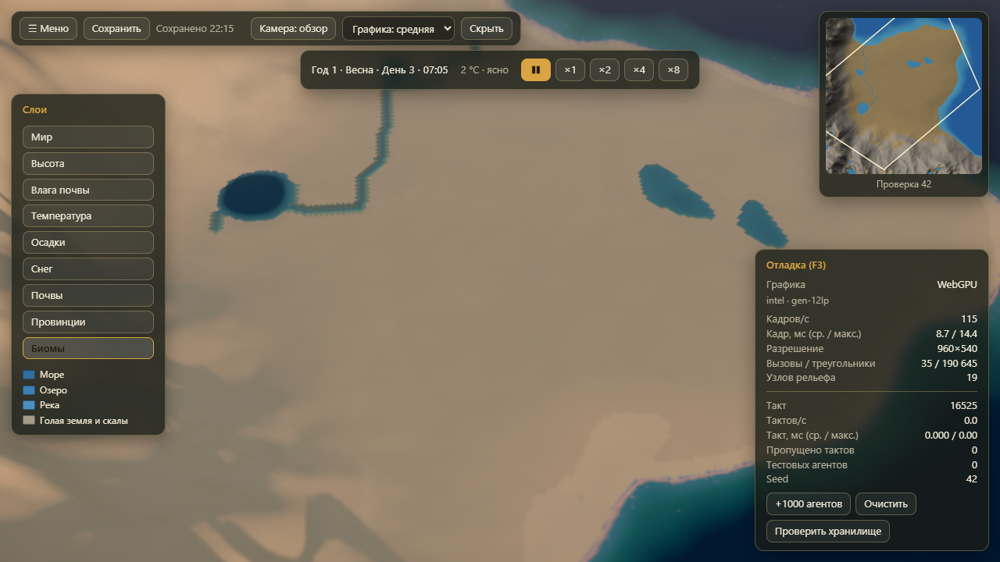
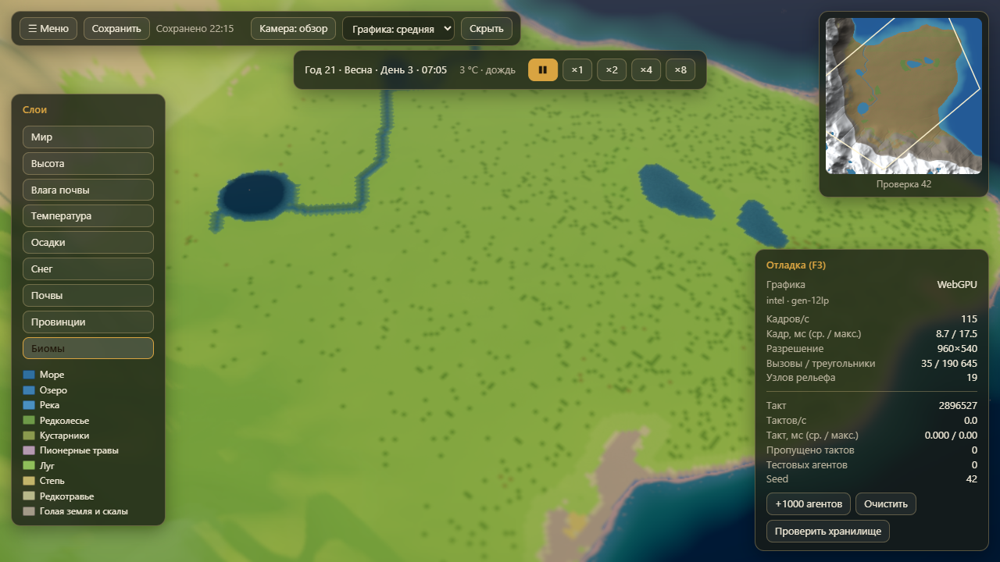
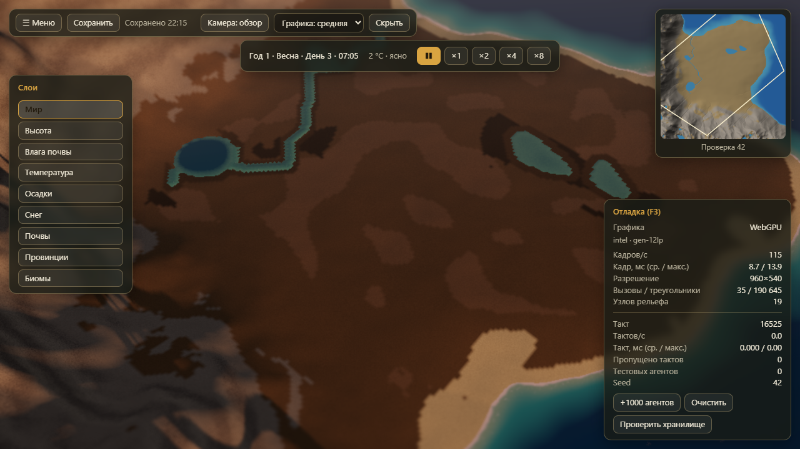
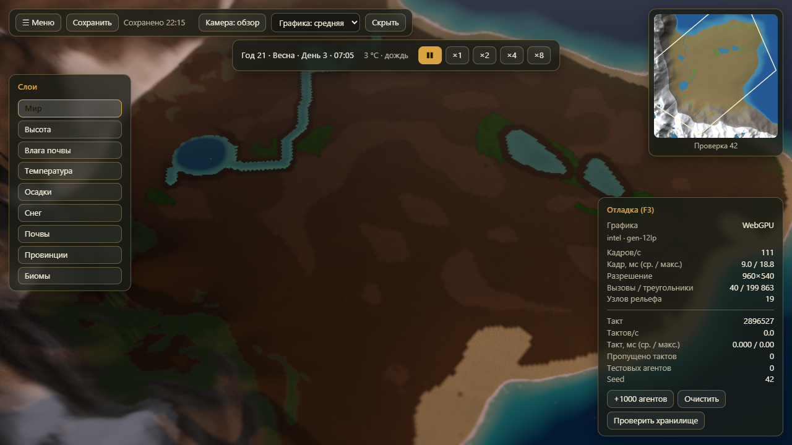

# WORLDBOUND — испытания сценариев Genesis и Wildlands (фаза 3, этап 4)

Дата: 2026-11-18 · Код: коммит `03795c1` (в каждом протоколе — полный SHA и признак незакоммиченных изменений кода `dirty`) · Сводка и выводы — `docs/PHASE3_PLAN.md`, раздел 15.

## 1. Что испытывалось

- **Genesis** — пустая земля без растений и семян. Дальше — обычная симуляция: колонизация через сухопутные края (если мир не изолирован) и размножение.
- **Wildlands** — та же пустая земля плюс почвенный банк семян трав региона; затем **20 игровых лет обычных тактов той же симуляции** с семенами региона на всю сушу. После подготовки семена региона выключаются, мир сохраняется готовым.

Ни один сценарий не ставит растения напрямую: всё, что есть в мире, проросло, выросло и выжило в симуляции.

## 2. Как мерили

- Инструмент `tools/wildlands-bench.ts`: генерирует мир, проводит подготовку (Wildlands) или обычный ход (Genesis), на отметках (5, 10, 20, 30, 40 лет) записывает время с начала подготовки, численность и стадии растений, биомассу, биомы, память; после подготовки — 1–2 игровых суток обычной игры с распределением длительности тактов.
- Протоколы: `docs/measurements/phase3-stage4-wildlands-S.json`, `…-S-climates.json`, `…-M.json`, `…-S-40y.json`, `phase3-stage4-genesis-S.json`, `phase3-stage4-genesis-M.json`; браузер — `phase3-stage4-wildlands-browser-S.json`, `…-M.json`.
- Машина: Intel Core i5-1235U (2 производительных + 8 энергоэффективных ядер), Iris Xe, 8 ГБ; от сети, схема питания «Сбалансированная»; Node 24. Повтор одной и той же работы на этой машине отличается до ±15 %.
- Это замеры **симуляции**, не частота кадров: растительность пока не рисуется (этап 5).
- «Подготовка, с» — время с начала прогона до отметки (нарастающим итогом); «мс/сутки» — средняя стоимость игровых суток за прогон до отметки. «Типов биомов суши» — число разных биомов, занявших хотя бы одну ячейку суши.

## 3. Ошибка, найденная замером, и повтор

Первая серия на коммите `b538b79` шла 2,5 ч (S 20 лет — 273–419 с, M — 21–25 мин). Профилирование одного года показало: около 70 % времени — классификатор биомов, создававший вспомогательные функции на каждое правило при каждом вызове. Исправлено в `03795c1`; хеш состояния после 2 лет мира S побитно тот же (`23ff90b2260ffa46`), год подготовки S — 21,2 → 2,0 с. Вся серия повторена на `03795c1` (42 мин); числа первой серии не используются.

## 4. Время подготовки Wildlands

| Мир | 5 лет | 10 лет | 20 лет | 40 лет |
|---|---|---|---|---|
| S (256 × 256 ячеек, 2 × 2 км), умеренный, seed 1–3 | 9–22 с | 26–47 с | **74–84 с** | 226 с (seed 1) |
| S, холодный, seed 1–2 | 16–18 с | 35–37 с | 72–78 с | — |
| S, тёплый, seed 1–2 | 23–26 с | 48–53 с | 103–114 с | — |
| M (512 × 512 ячеек, 4 × 4 км), умеренный, seed 1–3 | 42–98 с | 104–198 с | **362–451 с** | — |
| Браузер (воркер, Edge, сборка `vite build`, seed 42) | — | — | S: 130 и 185 с (два прогона); M: **797 с (13,3 мин)** | — |

Генерация рельефа (0,4–3,2 с) в эти числа не входит. Стоимость суток растёт вместе с числом древесных; самые дорогие сутки подготовки M — 1,7–2,2 с, в воркере они делятся на порции по 60 мс.

## 5. Подробные таблицы

### phase3-stage4-wildlands-S.json — 03795c1 dirty=false 2026-11-18T18:16:13.291Z

| Размер | Климат | Seed | Лет | Подготовка, с | мс/сутки | Древесных | Деревьев | Кустарников | Всходы/подрост/взрослые | Самое высокое, м | Кроны деревьев, % суши | Травы, т | Древесина, т | Видов пришло | Типов биомов суши | Память heap/RSS, МБ |
|---|---|---|---|---|---|---|---|---|---|---|---|---|---|---|---|---|
| S | temperate | 1 | 5 | 21,6 | 216,2 | 34 761 | 24 995 | 9 766 | 31 255/3 257/249 | 2,7 | 0 % | 177,4 | 1,6 | 18 | 4 | 14/92 |
| S | temperate | 1 | 10 | 47,3 | 236,4 | 57 614 | 41 751 | 15 863 | 33 197/20 571/3 846 | 6,7 | 0,1 % | 253,2 | 35,5 | 18 | 4 | 16/93 |
| S | temperate | 1 | 20 | 83,8 | 209,5 | 111 097 | 76 854 | 34 243 | 45 026/34 099/31 972 | 14,9 | 2,9 % | 301,9 | 674,2 | 18 | 6 | 17/94 |
| S | temperate | 2 | 5 | 8,9 | 89,4 | 27 881 | 20 692 | 7 189 | 24 680/3 029/172 | 2 | 0 % | 183,8 | 1,2 | 18 | 5 | 15/131 |
| S | temperate | 2 | 10 | 26,4 | 132,2 | 46 381 | 34 366 | 12 015 | 27 413/16 467/2 501 | 5,4 | 0,1 % | 203,8 | 28 | 18 | 5 | 13/130 |
| S | temperate | 2 | 20 | 74,1 | 185,3 | 91 396 | 62 910 | 28 486 | 39 073/26 883/25 440 | 14,3 | 2,4 % | 315,3 | 509,1 | 18 | 7 | 16/126 |
| S | temperate | 3 | 5 | 18,8 | 188 | 31 673 | 20 557 | 11 116 | 26 918/3 055/1 700 | 2,1 | 0 % | 256,4 | 2,6 | 18 | 4 | 13/126 |
| S | temperate | 3 | 10 | 38,8 | 194,2 | 59 195 | 35 292 | 23 903 | 33 059/16 309/9 827 | 5,2 | 0,1 % | 169,4 | 50 | 18 | 4 | 15/123 |
| S | temperate | 3 | 20 | 83,8 | 209,5 | 151 667 | 63 875 | 87 792 | 64 053/24 637/62 977 | 13,2 | 2,7 % | 237,3 | 632,7 | 18 | 6 | 12/126 |

Биомы суши (доля суши) на последней отметке:

- S temperate seed 1, 20 лет: луг 81,73 %, редкотравье 13,24 %, редколесье 2,95 %, болото 1,04 %, голая земля 0,72 %, кустарники 0,32 %
- S temperate seed 2, 20 лет: луг 81,23 %, редкотравье 14,93 %, редколесье 2,19 %, голая земля 1,11 %, болото 0,3 %, кустарники 0,24 %
- S temperate seed 3, 20 лет: луг 84,49 %, болото 9,45 %, голая земля 2,3 %, кустарники 1,49 %, редкотравье 1,41 %, редколесье 0,86 %

После подготовки (такты обычной игры):

| Размер | Климат | Seed | Генерация, с | Худшие сутки подготовки, мс | мс/сутки | такт: среднее / p95 / p99 / макс, мс | тактов > 40 мс | вода ср./макс | флора ср./макс | hash |
|---|---|---|---|---|---|---|---|---|---|---|
| S | temperate | 1 | 0,5 | 428 | 119,5 | 0.0166 / 0 / 0.56 / 3.89 | 0 | 3.486/16.64 | 0.819/12.55 | `110df0bda9141b5d` |
| S | temperate | 2 | 0,4 | 344 | 229 | 0.0318 / 0.001 / 1.015 / 6.36 | 0 | 3.064/10.02 | 0.727/8.72 | `ba436dc2ca2dcfb6` |
| S | temperate | 3 | 1 | 356 | 160,7 | 0.0223 / 0.001 / 0.719 / 6.1 | 0 | 3.358/7.76 | 0.831/10.56 | `11103032d858bd06` |

### phase3-stage4-wildlands-S-climates.json — 03795c1 dirty=false 2026-11-18T18:22:26.921Z

| Размер | Климат | Seed | Лет | Подготовка, с | мс/сутки | Древесных | Деревьев | Кустарников | Всходы/подрост/взрослые | Самое высокое, м | Кроны деревьев, % суши | Травы, т | Древесина, т | Видов пришло | Типов биомов суши | Память heap/RSS, МБ |
|---|---|---|---|---|---|---|---|---|---|---|---|---|---|---|---|---|
| S | cold | 1 | 5 | 16,3 | 162,5 | 15 318 | 12 445 | 2 873 | 15 035/283/0 | 0,6 | 0 % | 96,5 | 0,2 | 18 | 6 | 16/91 |
| S | cold | 1 | 10 | 36,7 | 183,3 | 23 057 | 19 149 | 3 908 | 17 022/5 933/102 | 2 | 0 % | 140,9 | 2,4 | 18 | 6 | 17/92 |
| S | cold | 1 | 20 | 78,2 | 195,4 | 37 484 | 32 463 | 5 021 | 17 920/10 336/9 228 | 6,9 | 0,2 % | 189 | 50,9 | 18 | 6 | 16/92 |
| S | cold | 2 | 5 | 17,5 | 174,9 | 10 750 | 8 347 | 2 403 | 10 654/96/0 | 0,7 | 0 % | 64,4 | 0,1 | 18 | 5 | 17/124 |
| S | cold | 2 | 10 | 35,3 | 176,7 | 15 501 | 12 416 | 3 085 | 11 957/3 501/43 | 2 | 0 % | 99,6 | 1,4 | 18 | 5 | 11/123 |
| S | cold | 2 | 20 | 72,3 | 180,6 | 24 089 | 20 216 | 3 873 | 12 833/5 654/5 602 | 6,1 | 0,1 % | 157,5 | 26,1 | 18 | 5 | 16/123 |
| S | warm | 1 | 5 | 25,8 | 258,3 | 41 848 | 28 912 | 12 936 | 30 616/10 106/1 126 | 2,9 | 0 % | 758,5 | 7,4 | 18 | 4 | 13/125 |
| S | warm | 1 | 10 | 53,4 | 267,2 | 71 283 | 48 062 | 23 221 | 32 692/30 469/8 122 | 9,3 | 0,6 % | 816,6 | 196,4 | 18 | 4 | 11/125 |
| S | warm | 1 | 20 | 113,8 | 284,4 | 150 980 | 95 635 | 55 345 | 57 577/44 641/48 762 | 18,1 | 7,2 % | 779,4 | 2 070,6 | 18 | 6 | 15/132 |
| S | warm | 2 | 5 | 22,7 | 227,1 | 34 738 | 23 961 | 10 777 | 25 269/8 368/1 101 | 4,4 | 0 % | 579,3 | 8,3 | 18 | 5 | 11/130 |
| S | warm | 2 | 10 | 47,7 | 238,6 | 64 223 | 40 523 | 23 700 | 30 912/25 359/7 952 | 9,1 | 0,6 % | 636,4 | 177,7 | 18 | 6 | 16/131 |
| S | warm | 2 | 20 | 103,1 | 257,8 | 140 168 | 78 378 | 61 790 | 55 016/35 299/49 853 | 18 | 6,2 % | 638,2 | 1 676 | 18 | 7 | 13/136 |

Биомы суши (доля суши) на последней отметке:

- S cold seed 1, 20 лет: луг 65,32 %, редкотравье 16,24 %, голая земля 12,73 %, тундра 5,3 %, пионерные травы 0,38 %, болото 0,02 %
- S cold seed 2, 20 лет: луг 57,09 %, голая земля 19,68 %, редкотравье 19,12 %, тундра 3,89 %, пионерные травы 0,23 %
- S warm seed 1, 20 лет: луг 58,89 %, редколесье 23,56 %, редкотравье 8,83 %, голая земля 5,25 %, болото 2,5 %, кустарники 0,97 %
- S warm seed 2, 20 лет: луг 57,08 %, редколесье 19,85 %, редкотравье 9,44 %, голая земля 7,68 %, кустарники 3,25 %, болото 2,66 %, степь 0,03 %

После подготовки (такты обычной игры):

| Размер | Климат | Seed | Генерация, с | Худшие сутки подготовки, мс | мс/сутки | такт: среднее / p95 / p99 / макс, мс | тактов > 40 мс | вода ср./макс | флора ср./макс | hash |
|---|---|---|---|---|---|---|---|---|---|---|
| S | cold | 1 | 0,5 | 358 | 165,9 | 0.023 / 0.001 / 0.326 / 6 | 0 | 3.968/18.92 | 0.641/10.93 | `8c56ef132397630b` |
| S | cold | 2 | 1,1 | 300 | 136,3 | 0.0189 / 0.001 / 0.238 / 4.23 | 0 | 3.839/24.15 | 0.557/5.6 | `7cca4c3d872e3ea8` |
| S | warm | 1 | 1,1 | 404 | 347,1 | 0.0482 / 0.001 / 1.68 / 11.23 | 0 | 4.301/8.3 | 1.193/12.83 | `cde34ff6d64cafe8` |
| S | warm | 2 | 0,9 | 378 | 316,9 | 0.044 / 0.001 / 1.479 / 8.89 | 0 | 3.85/8.03 | 1.084/9.9 | `d8b049ed0f09b532` |

### phase3-stage4-wildlands-M.json — 03795c1 dirty=false 2026-11-18T18:42:36.319Z

| Размер | Климат | Seed | Лет | Подготовка, с | мс/сутки | Древесных | Деревьев | Кустарников | Всходы/подрост/взрослые | Самое высокое, м | Кроны деревьев, % суши | Травы, т | Древесина, т | Видов пришло | Типов биомов суши | Память heap/RSS, МБ |
|---|---|---|---|---|---|---|---|---|---|---|---|---|---|---|---|---|
| M | temperate | 1 | 5 | 97,6 | 975,8 | 135 684 | 94 451 | 41 233 | 120 401/12 133/3 150 | 2,1 | 0 % | 698,7 | 7,5 | 18 | 4 | 18/168 |
| M | temperate | 1 | 10 | 198 | 989,8 | 235 888 | 160 797 | 75 091 | 132 499/76 600/26 789 | 6,5 | 0,1 % | 936,9 | 156,2 | 18 | 4 | 20/145 |
| M | temperate | 1 | 20 | 381,4 | 953,6 | 528 363 | 300 200 | 228 163 | 217 349/129 521/181 493 | 15,4 | 2,8 % | 1 096,8 | 2 509,9 | 18 | 7 | 21/145 |
| M | temperate | 2 | 5 | 41,8 | 417,7 | 151 854 | 102 407 | 49 447 | 129 723/16 127/6 004 | 2,8 | 0 % | 897,6 | 15,1 | 18 | 5 | 16/249 |
| M | temperate | 2 | 10 | 103,9 | 519,5 | 277 151 | 171 683 | 105 468 | 152 070/86 725/38 356 | 7,2 | 0,2 % | 914,1 | 262,9 | 18 | 5 | 12/254 |
| M | temperate | 2 | 20 | 361,6 | 904 | 698 198 | 315 762 | 382 436 | 292 000/129 172/277 026 | 15 | 2,8 % | 1 246,1 | 3 265,1 | 18 | 7 | 25/187 |
| M | temperate | 3 | 5 | 94,7 | 946,9 | 160 053 | 101 001 | 59 052 | 134 559/15 104/10 390 | 2,3 | 0 % | 1 287,3 | 15,1 | 18 | 4 | 11/274 |
| M | temperate | 3 | 10 | 197,4 | 987,1 | 311 496 | 174 626 | 136 870 | 168 991/83 592/58 913 | 6,2 | 0,1 % | 885,6 | 284,3 | 18 | 4 | 16/276 |
| M | temperate | 3 | 20 | 451,3 | 1 128,3 | 853 641 | 318 481 | 535 160 | 357 392/123 249/373 000 | 14,1 | 2,8 % | 1 083,7 | 3 446,2 | 18 | 6 | 24/299 |

Биомы суши (доля суши) на последней отметке:

- M temperate seed 1, 20 лет: луг 86 %, редкотравье 8,43 %, редколесье 1,91 %, болото 1,86 %, голая земля 1,02 %, кустарники 0,73 %, тундра 0,04 %
- M temperate seed 2, 20 лет: луг 79,65 %, редкотравье 10,35 %, болото 3,27 %, кустарники 2,98 %, редколесье 2 %, голая земля 1,74 %
- M temperate seed 3, 20 лет: луг 82,41 %, болото 10,65 %, кустарники 2,36 %, редкотравье 2,21 %, голая земля 1,61 %, редколесье 0,76 %

После подготовки (такты обычной игры):

| Размер | Климат | Seed | Генерация, с | Худшие сутки подготовки, мс | мс/сутки | такт: среднее / p95 / p99 / макс, мс | тактов > 40 мс | вода ср./макс | флора ср./макс | hash |
|---|---|---|---|---|---|---|---|---|---|---|
| M | temperate | 1 | 1,5 | 1 706 | 519,7 | 0.0722 / 0 / 2.694 / 21.51 | 0 | 17.051/42.28 | 3.58/54.08 | `c8c124a1685f8b5c` |
| M | temperate | 2 | 1,6 | 2 029 | 1 310,1 | 0.182 / 0.002 / 6.169 / 52.57 | 2 | 13.837/33.17 | 3.821/57.68 | `62e34d4c3255ec05` |
| M | temperate | 3 | 3,2 | 2 153 | 1 426,1 | 0.1981 / 0.002 / 7.16 / 61.39 | 2 | 17.003/28.99 | 4.787/63.83 | `2e5458ff3e322cc2` |

### phase3-stage4-genesis-S.json — 03795c1 dirty=false 2026-11-18T18:45:19.518Z

| Размер | Климат | Seed | Лет | Подготовка, с | мс/сутки | Древесных | Деревьев | Кустарников | Всходы/подрост/взрослые | Самое высокое, м | Кроны деревьев, % суши | Травы, т | Древесина, т | Видов пришло | Типов биомов суши | Память heap/RSS, МБ |
|---|---|---|---|---|---|---|---|---|---|---|---|---|---|---|---|---|
| S | temperate | 1 | 1 | 1,3 | 67,4 | 26 | 21 | 5 | 26/0/0 | 0,1 | 0 % | 0 | 0 | 17 | 1 | 14/88 |
| S | temperate | 1 | 2 | 6,7 | 166,8 | 47 | 42 | 5 | 47/0/0 | 0,3 | 0 % | 0 | 0 | 17 | 2 | 15/88 |
| S | temperate | 1 | 5 | 23 | 230 | 59 | 50 | 9 | 56/3/0 | 1 | 0 % | 0,2 | 0 | 18 | 3 | 13/90 |
| S | temperate | 1 | 10 | 57,3 | 286,4 | 100 | 73 | 27 | 84/5/11 | 3,8 | 0 % | 0,5 | 0 | 18 | 3 | 16/91 |
| S | temperate | 2 | 1 | 3,1 | 157,2 | 15 | 15 | 0 | 15/0/0 | 0,1 | 0 % | 0 | 0 | 17 | 1 | 12/114 |
| S | temperate | 2 | 2 | 9 | 224,5 | 31 | 27 | 4 | 31/0/0 | 0,1 | 0 % | 0 | 0 | 18 | 2 | 12/115 |
| S | temperate | 2 | 5 | 24,5 | 244,5 | 64 | 48 | 16 | 64/0/0 | 0,3 | 0 % | 0,1 | 0 | 18 | 3 | 12/123 |
| S | temperate | 2 | 10 | 54,7 | 273,7 | 56 | 47 | 9 | 49/2/5 | 2,8 | 0 % | 0,2 | 0 | 18 | 3 | 15/124 |
| S | temperate | 3 | 1 | 2,7 | 135,4 | 6 | 3 | 3 | 6/0/0 | 0,1 | 0 % | 0 | 0 | 17 | 1 | 11/123 |
| S | temperate | 3 | 2 | 7,4 | 184,7 | 21 | 16 | 5 | 21/0/0 | 0,1 | 0 % | 0 | 0 | 18 | 1 | 17/123 |
| S | temperate | 3 | 5 | 20,4 | 203,8 | 32 | 21 | 11 | 31/0/1 | 0,9 | 0 % | 0 | 0 | 18 | 1 | 14/123 |
| S | temperate | 3 | 10 | 46,5 | 232,7 | 33 | 24 | 9 | 33/0/0 | 0,5 | 0 % | 0 | 0 | 18 | 1 | 17/123 |

Биомы суши (доля суши) на последней отметке:

- S temperate seed 1, 10 лет: голая земля 99,76 %, луг 0,21 %, редкотравье 0,02 %
- S temperate seed 2, 10 лет: голая земля 99,91 %, луг 0,08 %, редкотравье 0,01 %
- S temperate seed 3, 10 лет: голая земля 100 %

После подготовки (такты обычной игры):

| Размер | Климат | Seed | Генерация, с | Худшие сутки подготовки, мс | мс/сутки | такт: среднее / p95 / p99 / макс, мс | тактов > 40 мс | вода ср./макс | флора ср./макс | hash |
|---|---|---|---|---|---|---|---|---|---|---|
| S | temperate | 1 | 0,5 | 231 | 139,8 | 0.0194 / 0.001 / 0.135 / 4.9 | 0 | 4.093/16.73 | 0.365/4.6 | `65b6b2a1e9535d6f` |
| S | temperate | 2 | 1 | 206 | 119,8 | 0.0166 / 0.001 / 0.097 / 4.4 | 0 | 3.902/13.2 | 0.345/2.79 | `f2848f51d2622961` |
| S | temperate | 3 | 1 | 173 | 98,9 | 0.0137 / 0.001 / 0.085 / 3.47 | 0 | 3.289/5.6 | 0.289/4.69 | `de0851ab3bef0358` |

### phase3-stage4-genesis-M.json — 03795c1 dirty=false 2026-11-18T18:47:15.545Z

| Размер | Климат | Seed | Лет | Подготовка, с | мс/сутки | Древесных | Деревьев | Кустарников | Всходы/подрост/взрослые | Самое высокое, м | Кроны деревьев, % суши | Травы, т | Древесина, т | Видов пришло | Типов биомов суши | Память heap/RSS, МБ |
|---|---|---|---|---|---|---|---|---|---|---|---|---|---|---|---|---|
| M | temperate | 1 | 1 | 12 | 602,5 | 21 | 16 | 5 | 21/0/0 | 0,1 | 0 % | 0 | 0 | 18 | 1 | 17/160 |
| M | temperate | 1 | 2 | 39,6 | 989,1 | 50 | 32 | 18 | 50/0/0 | 0,4 | 0 % | 0,1 | 0 | 18 | 3 | 14/161 |
| M | temperate | 1 | 5 | 111,4 | 1 113,6 | 98 | 79 | 19 | 93/3/2 | 2 | 0 % | 0,2 | 0 | 18 | 4 | 17/161 |

Биомы суши (доля суши) на последней отметке:

- M temperate seed 1, 5 лет: голая земля 99,99 %, луг 0,01 %

После подготовки (такты обычной игры):

| Размер | Климат | Seed | Генерация, с | Худшие сутки подготовки, мс | мс/сутки | такт: среднее / p95 / p99 / макс, мс | тактов > 40 мс | вода ср./макс | флора ср./макс | hash |
|---|---|---|---|---|---|---|---|---|---|---|
| M | temperate | 1 | 1,5 | 935 | 709,8 | 0.0986 / 0.001 / 1.99 / 22.26 | 0 | 19.556/29.85 | 1.371/13.4 | `be1832d7329a35e6` |

### phase3-stage4-wildlands-S-40y.json — 03795c1 dirty=false 2026-11-18T18:51:04.243Z

| Размер | Климат | Seed | Лет | Подготовка, с | мс/сутки | Древесных | Деревьев | Кустарников | Всходы/подрост/взрослые | Самое высокое, м | Кроны деревьев, % суши | Травы, т | Древесина, т | Видов пришло | Типов биомов суши | Память heap/RSS, МБ |
|---|---|---|---|---|---|---|---|---|---|---|---|---|---|---|---|---|
| S | temperate | 1 | 20 | 99,1 | 247,8 | 111 097 | 76 854 | 34 243 | 45 026/34 099/31 972 | 14,9 | 2,9 % | 301,9 | 674,2 | 18 | 6 | 14/95 |
| S | temperate | 1 | 30 | 158,5 | 264,2 | 187 287 | 129 292 | 57 995 | 68 792/43 642/73 934 | 19,3 | 10,2 % | 310,9 | 2 400,1 | 18 | 8 | 14/99 |
| S | temperate | 1 | 40 | 226,3 | 282,8 | 243 828 | 177 271 | 66 557 | 72 443/43 698/125 768 | 21,1 | 18,7 % | 269,4 | 4 655 | 18 | 9 | 19/109 |

Биомы суши (доля суши) на последней отметке:

- S temperate seed 1, 40 лет: луг 49,47 %, редколесье 39,87 %, широколиств. лес 3,98 %, кустарники 3,8 %, болото 1,33 %, смешанный лес 0,92 %, редкотравье 0,3 %, голая земля 0,27 %, хвойный лес 0,07 %

После подготовки (такты обычной игры):

| Размер | Климат | Seed | Генерация, с | Худшие сутки подготовки, мс | мс/сутки | такт: среднее / p95 / p99 / макс, мс | тактов > 40 мс | вода ср./макс | флора ср./макс | hash |
|---|---|---|---|---|---|---|---|---|---|---|
| S | temperate | 1 | 0,5 | 514 | 259,2 | 0.036 / 0.001 / 0.896 / 15.15 | 0 | 4.229/13.02 | 1.195/33.57 | `b35caae375697b8c` |

### Браузер: ход подготовки мира M (seed 42, `phase3-stage4-wildlands-browser-M.json`)

| Прошло, с | Год | Древесных | Оценка «осталось» | Осталось на деле |
|---|---|---|---|---|
| 104 | 4 из 20 | 135 654 | 7 мин 29 с | 11 мин 31 с |
| 202 | 7 из 20 | 161 815 | 7 мин 17 с | 9 мин 53 с |
| 404 | 12 из 20 | 288 266 | 5 мин 11 с | 6 мин 31 с |
| 600 | 16 из 20 | 492 392 | 2 мин 39 с | 3 мин 15 с |
| 703 | 19 из 20 | 563 757 | 1 мин 12 с | 1 мин 31 с |
| 791 | 20 из 20 | 676 047 | — | готово |

### Снимки (`docs/screenshots/phase3-stage4/`, seed 42, мир S, вид сверху)

| Genesis (1-й год) | Wildlands (21-й год) |
|---|---|
|  |  |
|  |  |

Слой «Биомы»: Genesis — вся суша «голая земля и скалы»; Wildlands — луг, редкотравье, редколесье и кустарники, у воды болото. Вид «Мир» снят ранней весной (3-й день, +3 °C): травы ещё не отросли после зимы, поэтому суша бурая; зелёные пятна у озёр Wildlands — кроны ольхи, ивы и берёзы. Сами растения пока не рисуются (этап 5). Также: прогресс подготовки (`wildlands-S-progress.png`, `wildlands-M-progress.png`) и слой биомов мира M (`wildlands-M-biomes.png`).

## 6. Выводы

1. **Wildlands за 20 лет — молодой ландшафт, а не лес.** Луг 57–86 % суши, редкотравье, болота у воды, рощи (редколесье 1–3 % в умеренном климате, 20–24 % в тёплом), тундра в холодном; сотни тысяч растений всех стадий, самые высокие деревья 13–18 м. Сомкнутые леса появляются к 30–40 годам (S seed 1: 40 лет — редколесье 40 %, широколиственный лес 4 %, смешанный 0,9 %, хвойный 0,1 %, покрытие кронами 19 %).
2. **Стоимость**: S — 1,2–1,9 мин в Node и 2,2–3,1 мин в браузере; M — 6–7,5 мин в Node и 13,3 мин в браузере. Оценка оставшегося времени для M занижена на 20–35 % (каждый следующий год дороже), для S точна. Подготовка идёт в воркере порциями с реальным прогрессом (год, доля тактов, число древесных, оценка оставшегося времени) и отменой.
3. **Genesis** честно пуст и в мирах S/M заселяется очень медленно: края — море (семена не приходят) и горы с низкой пригодностью; за 10 лет S — луг на 0–0,2 % суши, 33–100 древесных. На участке со всеми сухопутными краями (тест A) травы занимают > 60 % за 8 лет.
4. **Баланс вещества** во всех прогонах сходится с ошибкой ≤ 6,1·10⁻⁷ (допуск 10⁻⁴).
5. **Производительность после подготовки**: средний такт S — 0,02–0,03 мс, M — 0,07–0,20 мс; худший такт M с 0,5–0,85 млн древесных — 21–61 мс, 0–2 такта > 40 мс за двое суток (риск №18, этап 5).

## 7. Варианты

Нужно решение заказчика; без него ничего не меняется.

| Вопрос | Варианты | Цена и последствия |
|---|---|---|
| Подготовка M — 6–7,5 мин | (а) оставить 20 лет; (б) 10 лет для M; (в) точные оптимизации; (г) упрощённый шаг воды и погоды на время подготовки; (д) параллельный расчёт по областям | (а) — без изменений; (б) 1,7–3,3 мин, мир без кустарников и рощ; (в) порядка 1,5–2×, результат тот же; (г) ориентировочно 2×, мир «похожий», а не тот же; (д) большая работа, детерминизм доказывать заново |
| Лесов за 20 лет нет | (а) оставить; (б) выбор длительности 20 / 40 лет при создании; (в) леса вырастают уже в игре | (б) 40 лет: S 226 с, M оценочно 15–20 мин (не измерено) |
| Genesis в мирах S/M почти не зеленеет | (а) оставить (первичная сукцессия; создатель сеет сам — этап 6); (б) слабый дальний занос семян ветром и птицами на всю сушу в неизолированном мире | (б) меняет правило «колонизация только через края» |

## 8. Ограничения испытаний

- Браузерный замер — один seed (42) на размер; мир S — два прогона, M — один (13 мин); Node — 3 seed на размер и климат.
- Климаты «холодный» и «тёплый» измерены только на S.
- Отметка 40 лет — один seed S; для M не измерялась.
- Время подготовки зависит от машины и её состояния (±15 % на одной работе).
