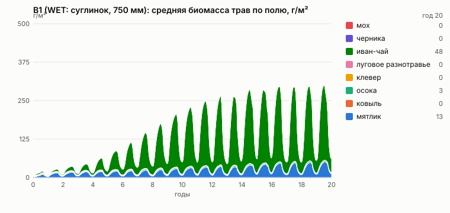
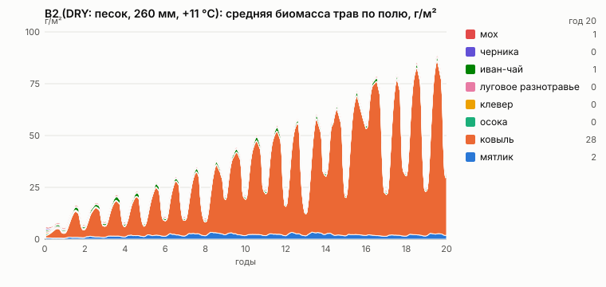
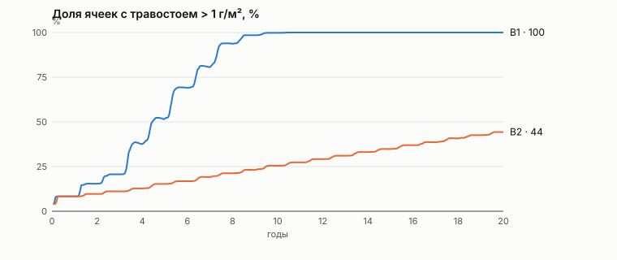
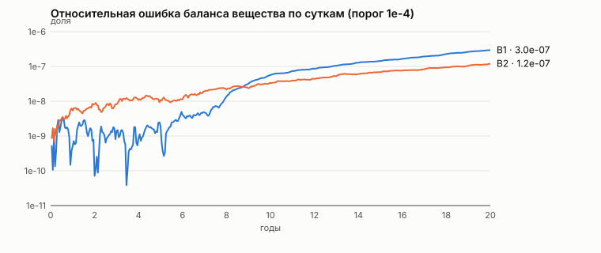

# WORLDBOUND — Unity Stage 2.3: травяной ярус

Дата: 2026-11-25 · Ветка: `experiment/unity-windows-prototype` · Эталон TS: `7b2fbabbc189f33a3181c7dbc72e54cd3aa8a65b` · Результаты: `docs/unity-stage2-3/`

На C# перенесён весь травяной ярус TS:
- рост и потери в два прохода с общими ограничениями ячейки (вместимость лучшего растущего вида, половина запаса питания);
- зимнее отмирание с корневым запасом, засуха, цена тени, азотфиксация;
- исчезновение локальной популяции в опад;
- семена в сезон плодоношения, расселение двумя пакетами по ядру вида, вынос за сушу в ведомость;
- прорастание банка семян с зазором травостоя и подстилкой;
- старение банка в опад;
- круговорот питания через ненулевой опад.

Модель роста не менялась: это перенос `processCell`, `disperseHerbSeeds`, `dispersalTarget`, `landCellAt`, `germinate`, `addLitterFast`, `herbFit` из `src/sim/flora/system.ts` с теми же точками округления.

**Результат.** Участки B1 (WET) и B2 (DRY), 20 игровых лет каждый, совпадают с настоящим TS `Simulation.stateHash()` **побитно**:
- после каждой из 144 порций первых суток B1;
- после каждых суток обоих участков;
- в .NET 6, редакторе Unity (Mono) и сборке Windows (Mono; вода — Mono или Burst).

Девять малых опытов и миры S/M с лугом на всей суше тоже совпадают побитно. Все 12 обязательных проверок пройдены. Ошибка баланса вещества за 20 лет — не больше 3,0·10⁻⁷ (порог 10⁻⁴), проверяется каждые сутки.

Древесные, колонизация, семена региона, подготовка Wildlands, секция `FLOR`, Burst и многопоточность для флоры, визуализация растительности, инструменты создателя и фауна не делались — по условию этапа.

## 1. Что перенесено

| C# | TS-источник | Содержание |
|---|---|---|
| `Sim/Flora/FloraSystem.cs`: `ProcessCell` (травяной ярус), `HerbFit`, `AddLitterFast`, `DispersalTarget`, `LandCellAt`, `DisperseHerbSeeds`, `Germinate` | `system.ts`: `processCell`, `herbFit`, `addLitterFast`, `dispersalTarget`, `landCellAt`, `disperseHerbSeeds`, `germinate` | Проходы 1–2, исчезновение, семена, расселение, прорастание, старение банка (раздел 2) |
| `FloraSystem.Unsupported` | — | Травы и банк семян разрешены; древесные, открытый мир и подготовка Wildlands по-прежнему остановлены явно (раздел 5) |
| `FloraSystem.Profile` / `FloraProfile` | — | Замер частей шага только для стендов; при `null` замеров нет, состояние не затрагивается |
| `SimTests/PlotGeo.cs` | `tests/support/plot.ts` (`plotGeo`) | Опытный участок только для тестов; совпадение с TS проверяется отпечатком статики |
| `SimTests/FloraG3BGolden.cs`, `tools/unity-flora-g3b-golden.ts` | — | Эталон G3 B и его проверка (раздел 3) |
| `unity/Tools/g3b-charts.py` | — | Графики состава из эталона (SVG, без внешних библиотек) |

Константы — как в TS:
- сезон семян `[0,4; 0,66)`, прорастания `[0,02; 0,4)`;
- исчезновение ниже 0,02 г/м²;
- цена тени 2, корневой запас 10 % предельной биомассы;
- система генератора расселения 312.

## 2. Порядок ячейки (как `processCell` TS)

1. Суточные средние, сброс накопителей (Stage 2.2). Свет у земли `groundLight`, холод: `T < 2` или снег > 5.
2. **Проход 1** по 4 слотам — от одной и той же картины ячейки (`total` — сумма слотов до шага, `nutrient` — запас до шага):
   - `fit = отклик T × влага × свет × почва`, вместимость `maxBiomass·√(fit·(0,3 + 0,7·nutrientResponse))`;
   - прирост `growth·dt·b·fit·nutrientResponse·(1 − total/capacity)` — если не холодно и есть место;
   - потери: смертность; зимой `dieback` 35 % сверх корневого запаса (листопадные кустарнички — 2 %); при `fit < 0,05` и T > 5 — 8 % в сутки; в тепле — цена тени `2·(1 − lightResponse)·dt·b`;
   - фиксация азота `fixes·dt·min(1, b/(0,5·maxBiomass))`.
3. **Проход 2:** общий множитель прироста — не выше вместимости лучшего растущего вида и не больше половины запаса питания. Затем запись слотов, опад потерь, ведомость (ассимиляция, опад, фиксация). Ниже 0,02 г/м² популяция исчезает: остаток уходит в опад, слот освобождается.
4. **Семена** (сезон, не холод, `fit ≥ 0,2`, `b ≥ 5`): `seedAlloc·dt/0,26·b·fit` уходит из биомассы. Половина — в банк своей ячейки, остальное — двумя пакетами по ядру `d = min(max, 3·mean·u²)`, направление `dcos/dsin`. `u, v` — счётчиковый генератор `(seed, 312, c·32 + s, day·64 + 2·пакет [+1])`. Пакет за краем мира или на воде — вынос из ведомости.
5. **Прорастание** (сезон, T > 6, снег < 1): для каждого вида с банком ≥ 0,002 и `fit ≥ 0,15` — `bank·min(1, establishment·fit·зазор·подстилка·dt·6)`. Свой слот пополняется, иначе занимается первый свободный.
6. **Старение банка**: `bank·min(1, dt/лет хранения)` уходит в опад.
7. Почва, покров, биом (Stage 2.2) — теперь на ненулевом опаде и с травостоем.

**Точки округления.** Как в TS: всё считается в double, во float32 округляется только запись в массив состояния. Значения float читаются в double до арифметики: `f.SlotBiomass[k] + g − loss`, `bank − dead`, `1 + litterFast/litterHalf`. Рабочие массивы прохода 1 — статические `double[4]`, как модульные `Float64Array` TS. Флора всех симуляций идёт под `BiomeState.Gate`, поэтому общий буфер безопасен.

## 3. Эталон G3 B

Данные готовит настоящий TS (`npx tsx tools/unity-flora-g3b-golden.ts`, Node v24.22.1) → `unity/WorldboundProto/Golden/flora-g3b.json` (вне `Assets`, в сборку не попадает). Ожидаемые массивы вручную не писались.

**Начальное состояние** задаётся декларативно (заливки по столбцам) и применяется одинаково в TS и C#:
- слоты, банк семян, запас питания — по ячейкам суши;
- затем `refreshCover(world, true)`, обнуление ведомости и точка отсчёта баланса — как в `plantSourceStrip`.

Совпадение начальной настройки подтверждено полным `stateHash` на такте 0. Статика участка (`plotGeo`, перенесён в `SimTests/PlotGeo.cs`) сверяется отпечатком: FNV 23 массивов статики и производных (ёмкость почвы, множитель осадков, дренаж), края, ветер, сетки высот.

| Опыт | Участок | Начальное состояние | Срок |
|---|---|---|---|
| **B1** | `WET`: 48 × 48, суглинок, 750 мм, плодородие 0,8 | `plantSourceStrip` без древесных: столбцы 0–3 — банк всех трав 1 г/м², столбцы 2–3 — луг из всех 8 трав по очереди, 40 г/м² | 20 лет (400 суток) |
| **B2** | `DRY`: 48 × 48, песок, 260 мм, плодородие 0,3, +11 °C | то же | 20 лет |
| growth | 32 × 32, WET | мятлик 5 г/м² на всём участке | 1 год |
| competition | 32 × 32, WET | все 8 трав, 4 в ячейке по 150 г/м², без банка | 1 год |
| nutrient-poor / -rich | 32 × 32, плодородие 0 / 0,8 | иван-чай и мятлик по 20 г/м²; на бедной почве запас питания 0,3 г/м² | 1 год |
| frost | 32 × 32, +0 °C ± 16, 600 мм | мятлик 200, черника 200, мох 150 | 1 год |
| drought | 32 × 32, DRY | осока 100, ковыль 100 | 8 лет |
| dispersal | 32 × 32, WET, река в столбцах 0–2 | луг в столбцах 3–6, 60 г/м² | 1 год |
| germination | 32 × 32, WET | только банк всех трав, 0,5 г/м² | 1 год |
| aging | 32 × 32, DRY | только банк осоки 2 г/м² (на сухом песке не прорастает) | 1 год |
| full-S / full-M | Genesis S/42, M/42 | луг 4 × 40 г/м² и банк всех трав 1 г/м² на всей суше | 2 суток (+ 5 суток замеров) |

Каждые сутки сверяются:
- `stateHash`, такт, доля года;
- 10 статей ведомости, запас, бюджет, ошибка баланса (биты IEEE-754);
- число ячеек каждого биома;
- по каждой траве — сумма биомассы, число слотов, сумма банка семян;
- занятые ячейки (> 1 г/м²), новые ячейки за опушкой, фронт, сумма покрова и опада;
- FNV 16 массивов (слоты, банк, питание, опад, средние, покров, влага, следы биома) — каждые 20 суток и в конце.

Для B1 дополнительно сверяется `stateHash` после каждой из 144 порций первых суток.

### 3.1. Итог сравнения

| Часть | Проверок | Расхождений |
|---|---:|---:|
| B1 (WET), 400 суток + 144 порции | 23 367 | 0 |
| B2 (DRY), 400 суток | 23 223 | 0 |
| 9 малых опытов | 19 311 | 0 |
| Нагрузка S/M | 406 | 0 |
| 12 обязательных проверок и защита (раздел 4) | 686 612 | 0 |
| **Всего (.NET 6)** | **752 919** | **0** |

Контрольные хеши (TS = C#):
- B1: такт 0 — `e2f80e030eb3d93a`; порция 1 — `59a96820ab6e9cb6`; сутки 1 — `2d8c22df2617b5e5`; сутки 400 — `854a462cdd45a91c`;
- B2: такт 0 — `f4f21a6c4c003f98`; сутки 1 — `6774f3371a66cd5d`; сутки 400 — `2c77bb1616d38f5b`;
- full-S, сутки 2 — `00c7d5317b70b7e4`; full-M, сутки 2 — `f3b255310e9666e6`.

### 3.2. Состав трав (середина лета, среднее по полю 48 × 48, г/м²)

| B1 (WET), год | мятлик | ковыль | осока | клевер | разнотравье | иван-чай | черника | мох | занято, % | фронт, столбец | банк, г/м² |
|---|---:|---:|---:|---:|---:|---:|---:|---:|---:|---:|---:|
| 1 | 6,1 | 0,7 | 1,0 | 1,7 | 0,9 | 4,6 | 0,8 | 0,8 | 8,3 | 3 | 0,89 |
| 2 | 13,7 | 0,3 | 1,4 | 3,0 | 0,6 | 5,0 | 0,7 | 0,6 | 14,7 | 25 | 1,59 |
| 5 | 18,0 | 0,0 | 2,7 | 1,8 | 1,2 | 33,6 | 0,5 | 0,4 | 49,0 | 43 | 4,23 |
| 10 | 25,5 | 0,0 | 4,1 | 1,5 | 0,6 | 157,7 | 0,4 | 0,2 | 99,6 | 47 | 12,67 |
| 15 | 36,9 | 0,0 | 4,5 | 1,0 | 0,4 | 233,6 | 0,3 | 0,1 | 100,0 | 47 | 19,33 |
| 20 | 46,4 | 0,0 | 5,0 | 0,6 | 0,3 | 239,2 | 0,2 | 0,1 | 100,0 | 47 | 22,44 |

На влажном суглинке иван-чай (лёгкие семена, дальность до 400 м) за 8–10 лет заселяет всё поле. Мятлик и осока идут следом. Ковыль исчезает на 10-м году (сухолюбивый вид на влажной почве). Медленные черника и мох уступают в конкуренции и держатся только на опушке. Биомы через 20 лет: 1902 ячейки «Пионерные травы», 402 — «Луг», голой земли нет.

| B2 (DRY), год | мятлик | ковыль | осока | клевер | разнотравье | иван-чай | черника | мох | занято, % | фронт, столбец | банк, г/м² |
|---|---:|---:|---:|---:|---:|---:|---:|---:|---:|---:|---:|
| 1 | 0,5 | 3,2 | 0,3 | 0,4 | 0,5 | 0,5 | 0,4 | 0,6 | 8,3 | 3 | 0,57 |
| 2 | 0,9 | 10,9 | 0,1 | 0,2 | 0,5 | 1,0 | 0,3 | 0,6 | 8,8 | 5 | 0,61 |
| 5 | 1,7 | 16,5 | 0,0 | 0,0 | 0,2 | 1,1 | 0,2 | 0,6 | 14,0 | 7 | 0,91 |
| 10 | 2,6 | 37,1 | 0,0 | 0,0 | 0,1 | 1,2 | 0,2 | 0,6 | 24,1 | 13 | 1,81 |
| 15 | 1,9 | 56,8 | 0,0 | 0,0 | 0,0 | 0,7 | 0,2 | 0,5 | 33,9 | 18 | 2,69 |
| 20 | 2,5 | 77,8 | 0,0 | 0,0 | 0,0 | 1,1 | 0,2 | 0,7 | 43,0 | 22 | 4,07 |

На сухом бедном песке побеждает ковыль. Осока исчезает на 5-м году. У клевера к 15-му году не остаётся ни одного слота, дальше появляются лишь единичные всходы из банка. Поле зарастает медленно: фронт — около столбца в год, к 20-му году занято 43 %. Биомы через 20 лет: 923 ячейки «Степь», 1322 — голая земля, остальное — «Пионерные травы», «Луг», «Редкотравье».

Зубцы на графиках состава — зимнее отмирание надземной части с корневым запасом и весеннее отрастание.

### 3.3. Баланс вещества

Ошибка `|запас − начальный − бюджет| / начальный` проверяется **каждые сутки** во всех 13 прогонах: B1, B2, 9 опытов, S/M. Максимум — 2,95·10⁻⁷ (B1), 1,20·10⁻⁷ (B2), не больше 2·10⁻⁸ в опытах; порог 10⁻⁴. Рост на 2–3 порядка за 20 лет — накопление округлений float32 в слотах, банке и опаде (у голой земли G3 A — 10⁻⁹). Динамика у TS и C# одна и та же: числа совпадают побитно.

Потоки ведомости за 20 лет (из эталона; элемент питания — в кг, биомасса — в т):

| | B1 (WET) | B2 (DRY) |
|---|---:|---:|
| Запас питания: начало → конец, кг | 1181 → 1237 | 592 → 377 |
| Выветривание, кг | 4954,5 | 2595,2 |
| Вымывание, кг | 4887,5 | 2808,9 |
| Фиксация азота (клевер), кг | 37,3 | 1,2 |
| Вынос семенами за сушу, кг | 48,4 | 2,1 |
| Ассимиляция, т | 742,2 | 134,1 |
| Опад, т | 727,6 | 129,7 |
| Разложение опада, т | 685,0 | 119,2 |

Разложение теперь идёт на ненулевом опаде (в Stage 2.2 — только на нулевом). На сухом песке вымывание больше выветривания, и запас питания убывает. На влажном суглинке травостой удерживает питание в обороте, и запас растёт.

### 3.4. Чувствительность эталона

Проверено подменами в C# с последующим возвратом (`g3b`, 20 суток).

| Подмена | Результат |
|---|---|
| Опад: сложение во float (`litterFast + (float)perM2`) | Расхождение с порции 31 B1; во всех опытах — со вторых суток |
| Расселение: другое случайное число для дальности (`day·64 + 2·пакет + 1`) | Расхождение с первых суток сезона семян (сутки 6): вынос, опад, хеш |
| Подстилка при прорастании: частное округлено во float | Расхождение с порции 67 B1, в B2 — с первых суток |
| Порог исчезновения `<` → `<=` | **Не обнаруживается**: биомасса ровно 0,02 г/м² в эталонах не встречается, подмена эквивалентна на этих данных |

## 4. Двенадцать обязательных проверок

Проверки свойств модели считаются по состоянию C# — независимо от эталона, хотя само состояние совпадает с TS побитно. Проверки «после порции» сравнивают снимок до порции с состоянием после неё. Обрабатываемые ячейки берутся по правилу нарезки (строки z ≡ час mod 24, шестая часть столбцов).

| № | Проверка | Где | Как | Итог |
|---|---|---|---|---|
| 1 | Рост | growth | Биомасса мятлика растёт каждые сутки весны (8,6 → 184 г/м² за 6 суток), ассимиляция > 0 | OK |
| 2 | Конкуренция ≤ вместимости | B1, B2, все опыты | После каждой порции в каждой обработанной ячейке вне прорастания: сумма слотов ≤ max(было, вместимость лучшего вида) (допуск 10⁻⁶ на округление float32). Переполненный луг сокращается | OK: 149 761 порция, 1 509 123 ячейки |
| 3 | Предел питания | B1, B2, nutrient-poor/-rich | Σ Δb·N ≤ 0,5·запаса. Предел действительно связывал: потребность прохода 1 больше половины запаса — 114 733 ячейки. Пик биомассы на бедной почве 52 г/м² против 356 на богатой | OK: 120 962 порции, 1 362 785 ячеек |
| 4 | Мороз и засуха | frost, drought | В холод (T < 2 или снег > 5) прироста нет, у видов с отмиранием — потеря ≥ 35 % сверх корневого запаса (38 288 холодных ячеек). Засуха: осока за год убывает больше чем вдвое и исчезает к 6-му году, ковыль занимает все 1024 ячейки | OK |
| 5 | Исчезновение → опад | B1, B2, опыты | Слот без вида — биомасса ровно 0; исчезновение популяции только с ростом опада в ведомости | OK: 26 669 исчезновений |
| 6 | Окно плодоношения | B1, B2, dispersal, germination | Банк пополняется только при доле года в [0,4; 0,66) | OK: 641 915 пополнений, все в сезон |
| 7 | Расселение: детерминизм, не в воду | dispersal, B1 | Банк семян на воде 0 каждые сутки; вынос 79,3 г элемента питания; семена за пределами луга; повторный прогон — тот же хеш; фронт B1 на 10-м году — столбец 47 (край) | OK |
| 8 | Прорастание | germination, B1, B2 | Новая популяция появляется только в сезон прорастания, в ячейке порции, при T > 6 и без снега. Голая земля с банком заселяется за 5 суток весны | OK: 34 172 всхода |
| 9 | Старение банка → опад | aging | После каждой порции банк каждой ячейки равен ровно `(float)(bank − bank·min(1, dt/лет))`, рост опада в ведомости равен сумме отмерших семян (10⁻⁹ отн.) | OK: 20 480 значений |
| 10 | Баланс за 20 лет | все прогоны | Ошибка ≤ 10⁻⁴ каждые сутки | OK: ≤ 2,95·10⁻⁷ |
| 11 | Детерминизм | B1 | Повторный прогон 40 суток — тот же хеш, что в эталоне; TS = .NET 6 = Mono = сборка | OK |
| 12 | Биомы и покров | B1, B2 | Во всех ячейках с травостоем покров > 0 и тень травы < 1. B1: «луг» и «пионерная» > 50 % поля (2304 из 2304). B2: «степь» 923 ячейки, больше чем в B1. Контроль — голая земля G3 A остаётся barren | OK |

Свет и биомы отвечают составу трав:
- покров (вход испарения) считается по биомассе трав;
- тень травостоя (`herbShade`) готова для всходов древесных;
- классификатор биомов получает доли «луговых», «степных», «влажных», «пионерных» трав и даёт разные биомы на WET и DRY.

## 5. Защита неперенесённых ветвей

`FloraSystem.Unsupported` больше не блокирует травы и банк семян. Явная остановка (`FloraNotPortedException` в шаге и причина в `Simulation.FloraUnsupported`, приложение показывает её и не ведёт такты) осталась для:
- живых древесных — «есть древесные растения — этап 2.4»;
- открытого мира — «мир открыт колонистам извне (колонизация через край) — этап 2.5»;
- подготовки Wildlands — «идёт подготовка Wildlands (семена региона) — этап 2.5».

Проверено (часть «защита» G3 B):
- мир с травами и банком ведётся;
- тот же мир с одной елью заблокирован, и шаг останавливается исключением в пределах суток;
- открытый Genesis и Wildlands заблокированы.

Частичного молчаливого выполнения нет.

## 6. Производительность

Флора — управляемый C#, без Burst и без многопоточности ячеек (по условию). Время порции — такт с порцией флоры (в нём идёт только флора). Сутки — 7200 тактов: погода, вода, флора.

**Нагрузка «луг на всей суше»** (S: 49 530 ячеек суши, 198 120 занятых слотов; M: 197 529 ячеек, 790 116 слотов; первые 2 суток — весна):

Порция флоры, мс (среднее / p95 / p99), первые 2 суток (весна, прорастание):

| | TS (Node 24) | .NET 6 | Редактор (Mono) | Сборка (Mono) |
|---|---|---|---|---|
| S | 0,496 / 1,081 / 1,585 | 0,490 / 0,846 / 1,075 | 0,422 / 0,957 / 1,374 | 0,303 / 0,544 / 0,776 |
| M | 2,018 / 3,964 / 5,166 | 0,958 / 1,740 / 2,209 | 1,793 / 3,272 / 4,508 | 1,304 / 2,188 / 2,794 |

Сутки (погода, вода, флора), мс в среднем: TS — S 162, M 618; .NET 6 — S 231, M 489; редактор — S 194, M 855; сборка — S 148, M 620. В сборке с водой на Burst — S 74, M 311.

**Разбивка суток флоры по частям** (.NET 6; `FloraProfile`, отдельные сутки с замерами; весна — сутки 3, доля года 0,24; плодоношение — сутки 7, доля года 0,44):

| Часть, мс за сутки | S весна | S плодоношение | M весна | M плодоношение |
|---|---:|---:|---:|---:|
| Травы, проходы 1–2 | 32,3 | 33,8 | 59,2 | 67,6 |
| Семена и расселение | 3,2 | 60,0 | 5,7 | 150,8 |
| Прорастание | 33,5 | 2,8 | 66,3 | 6,0 |
| Старение банка | 12,2 | 14,7 | 24,0 | 29,4 |
| Почва | 7,2 | 7,0 | 16,8 | 17,3 |
| Покров и биом | 25,4 | 30,5 | 61,0 | 65,4 |
| **Флора за сутки** | **113,8** | **148,8** | **233,0** | **336,5** |
| то же на порцию (÷ 144) | 0,79 | 1,03 | 1,62 | 2,34 |

То же по средам — флора за сутки, мс (на порцию):

| | S весна | S плодоношение | M весна | M плодоношение |
|---|---:|---:|---:|---:|
| .NET 6 | 113,8 (0,79) | 148,8 (1,03) | 233,0 (1,62) | 336,5 (2,34) |
| Редактор (Mono) | 96,5 (0,67) | 130,0 (0,90) | 436,3 (3,03) | 611,8 (4,25) |
| Сборка (Mono, вода Mono) | 75,8 (0,53) | 103,4 (0,72) | 342,2 (2,38) | 451,5 (3,14) |
| Сборка (Mono, вода Burst) | 78,4 (0,54) | 99,8 (0,69) | 314,2 (2,18) | 418,2 (2,90) |

Самая дорогая часть — расселение в сезон семян: 596 тыс. семенных слотов в сутки M, на каждый — два пакета с двумя хешами и `dsin/dcos`. Весной её место занимает прорастание: 8 видов на каждую ячейку.

**Память и GC** (.NET 6, только внутри шагов ядра):
- выделений памяти — 0 байт (.NET 6), сборок поколения 0 — 0 во всех средах (редактор и сборка: счётчик `GC.CollectionCount(0)` вокруг шагов);
- состояние флоры — 10,8 МБ (S) и 43,3 МБ (M) без хранилища древесных; хранилище древесных — 262 144 места (S).

**Участки B1/B2** (48 × 48, 20 лет; порция — среднее / p99, мс; сутки — среднее, мс):

| | TS | .NET 6 | Редактор | Сборка, вода Burst |
|---|---|---|---|---|
| B1 порция | 0,019 / 0,084 | 0,013 / 0,042 | 0,014 / 0,053 | 0,010 / 0,030 |
| B1 сутки | 6,8 | 8,7 | 8,4 | 4,0 |
| B2 порция | 0,016 / 0,064 | 0,010 / 0,033 | 0,012 / 0,047 | 0,008 / 0,026 |
| B2 сутки | 6,3 | 8,5 | 8,2 | 3,7 |

**Выводы.**
- Управляемая флора одних трав на всей суше M в худшие сутки (плодоношение) стоит 2,3 мс на порцию в .NET 6, 2,9–3,1 мс в сборке Mono и 4,3 мс в редакторе.
- Самая дорогая часть — расселение. Следом идут проходы трав и покров с биомом. Последний в Mono заметно дороже, чем в .NET.
- В .NET порция S в начале прогона медленнее на ячейку, чем M: S идёт первой, сказываются прогрев и кэши. Сравнивать стоит сутки с разбивкой по частям.
- Замеры сняты на ноутбуке: Intel Core i5-1235U, 12 потоков, 7,9 ГБ; Windows 11; Unity 6000.3.29f1; Mono + Burst. Время одного прогона, без повторов: это измерения, а не оценки, но разброс между прогонами — десятки процентов. Прогон .NET, снятый параллельно с другой нагрузкой, отброшен и переснят.

## 7. Регрессия предыдущих этапов

| Проверка | .NET 6 | Редактор | Сборка |
|---|---|---|---|
| Генератор, 6 миров | OK | OK | OK |
| Среда «только погода и вода» (Mono; Burst) | OK | OK; OK | OK; OK |
| Сохранение S, M (M — Burst) | OK | OK | OK |
| Устойчивость WBSV (27 + 2) | OK | OK | OK |
| Темп и пауза, хост | OK | OK | OK |
| G0/G1 (55 148) | OK | OK | OK |
| `WoodyRestoreCheck` | OK | OK | OK |
| G2 (956) | OK | OK | OK |
| G3 A, голая земля 20 лет (25 239) | OK | OK | OK (вода Burst; Mono — 25 суток, 7177) |
| **G3 B, травяной ярус (752 919)** | OK | OK | OK (вода Burst; Mono — 40 суток, 192 180) |

Также проверено:
- G3 A с перенесённым травяным ярусом не изменилась: на голой земле ветви трав пусты, хеши прежние.
- **Сборка Windows:** 101,8 МБ, 0 ошибок и предупреждений. Эталонных данных и тестовых сборок в ней нет (`build-contents-check.json`).
- **Вода и погода не изменены**, TS-исходники эталона не изменены (снимок `7b2fbabbc1`).
- **TS-инструмент** проходит `tsc` (`npm run typecheck`) и `eslint`. Повторная генерация эталона даёт то же содержимое (кроме замеров времени).

## 8. Оставшиеся ограничения

1. **Древесные, колонизация, семена региона, Wildlands** не перенесены (этапы 2.4–2.5); такие миры явно остановлены (раздел 5).
2. **Сохранение не содержит флору** (`FLOR` — этап 2.6). Травостой, банк семян, опад и запас питания после загрузки начинаются заново. В приложении мир Genesis без растений, и создать травы в нём нельзя (инструментов создателя нет). Ограничение касается только тестовых миров.
3. **Mono медленнее .NET 6** (раздел 6). Цель заказчика — p99 порции M на Burst ≤ 5 мс при ×8 — относится к полной флоре с древесными и будет проверяться на этапе 2.7 с Burst. Сейчас управляемая флора одних трав на всей суше M — в среднем 2,3 мс на порцию в сезон семян (.NET 6); значение Mono — в разделе 6.
4. **Порог исчезновения `<` / `<=`** эталоном не различается (раздел 3.4). Код повторяет TS (`<`).
5. **Эталон рассчитан на сезон 5 суток** (по умолчанию), как и G3 A.
6. **Опытный участок `PlotGeo`** — только тестовая поддержка, в игре не используется. Его строка `geoHash` (`plot-{…}`) берётся из эталона: это идентификатор, а сама статика сверяется отпечатком.

## 9. Коммиты

Ветка `experiment/unity-windows-prototype`; `main` не изменялся, ветки не объединялись, история не переписывалась.

| Коммит | Содержание |
|---|---|
| [`1000e8e`](https://github.com/ashkerov/worldbound/commit/1000e8e) | Травяной ярус в `FloraSystem`, снятие защиты для трав и банка семян, замеры частей шага |
| [`2e4787d`](https://github.com/ashkerov/worldbound/commit/2e4787d) | Эталон G3 B из настоящего TS, проверка C# с 12 обязательными проверками, `PlotGeo`, подключение к `simcli`, редактору и сборке |
| коммит с этим отчётом | Отчёт, графики, результаты (`docs/unity-stage2-3/`), обновление `PROJECT_CONTEXT.md`, `ARCHITECTURE.md`, `DEVELOPMENT_PLAN.md`, `docs/UNITY_MIGRATION_STAGE2_PLAN.md` |
