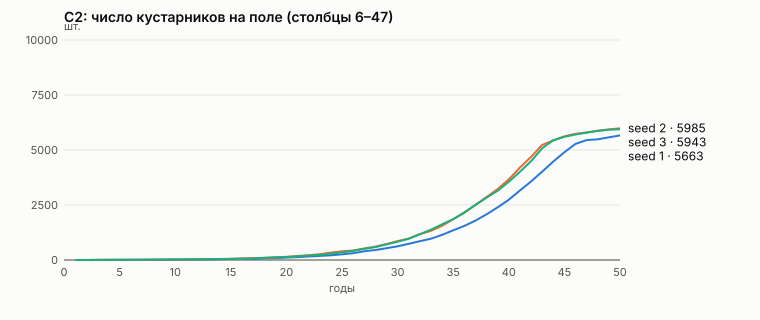
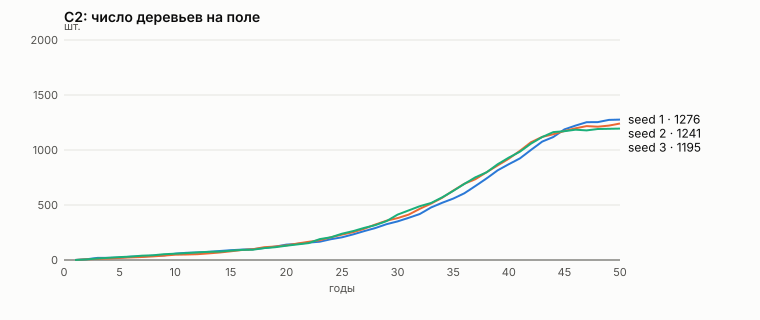
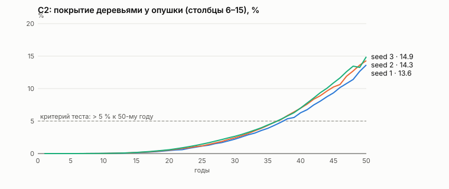
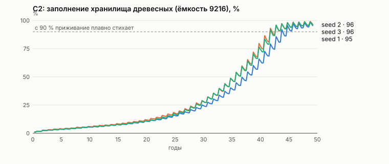

# WORLDBOUND — Unity Stage 2.4: древесные растения

Дата: 2026-11-26 · Ветка: `experiment/unity-windows-prototype` · Эталон TS: `7b2fbabbc189f33a3181c7dbc72e54cd3aa8a65b` · Результаты: `docs/unity-stage2-4/`

На C# перенесены древесные TS целиком:
- фенология лиственных и вечнозелёных;
- рост по аллометрии с питанием не больше 30 % запаса ячейки, азотфиксация ольхи;
- оборот древесины, коры и хвои;
- здоровье, стресс, морозные повреждения, старение, стадии, смертность;
- смерть в опад с освобождением индекса;
- семена (не больше 5 % биомассы, не больше 8 пакетов), расселение, приживание всходов с плавным пределом хранилища.

Деревья, кустарники и травы образуют одну связанную систему:
- полог затеняет травы, и под ним побеждают теневыносливые;
- травостой затеняет всходы;
- деревья берут и возвращают питание через почву и опад;
- биомы следуют за пологом.

**Результат.** Все сценарии G3 C совпадают с настоящим TS `Simulation.stateHash()` **побитно**:
- C1 — стенд 10 000 древесных с лугом: после каждой из 144 порций первых суток, затем каждые сутки;
- C2 — сукцессия WET для seed 1, 2, 3 по 50 лет: каждые сутки;
- все исходные тесты TS о древесных;
- миры S и M с 75 и 300 тыс. древесных.

Совпадение подтверждено в .NET 6, редакторе Unity (Mono) и сборке Windows — на Mono и отдельно с водой на Burst: 1 108 042 проверки в каждой среде, 0 расхождений. Критерии `flora-succession.test.ts` выполнены для всех трёх seed. Ошибка баланса вещества — не больше 1,4·10⁻⁵ при пороге 10⁻⁴; у сценариев, где начальная точка баланса задана, — не больше 6,7·10⁻⁷.

Колонизация, семена региона, подготовка Wildlands, секция `FLOR`, Burst и многопоточность для флоры, визуализация, инструменты создателя и фауна не делались — по условию этапа.

## 0. Проверка Stage 2.3 и разделение сборок

- Рабочее дерево было чистым, ветка совпадала с `origin`, последний коммит Stage 2.3 — `10ed1a0`.
- Эталон G3 B (`Golden/flora-g3b.json`) остаётся регрессионным и прогоняется везде. Его часть «защита» обновлена: мир с деревом теперь ведётся, а открытый мир и Wildlands по-прежнему остановлены.
- **Неточность 1** (`docs/UNITY_STAGE2_3_REPORT.md`): в сборке полный G3 B на 400 суток шёл с водой на Burst и флорой на Mono; вариант, где и вода на Mono, — на 40 сутках. Теперь это сказано явно.
- **Неточность 2:** в сборку попадала тестовая сборка `Worldbound.Sim.Golden.dll` (156 672 байта) — код golden-проверок для `-wbsimtest`, без данных эталонов. Сборки разделены:

| Сборка | Как собрать | Папка | Golden-код |
|---|---|---|---|
| **QA** — для автоматических проверок | `BuildTools.BuildWindows` (define `WB_QA`) | `Build/Windows` | есть: `-wbsimtest`, сравнение рендера с эталоном |
| **Release** — то, что получает игрок | `BuildTools.BuildWindowsRelease` | `Build/WindowsRelease` | нет: `-wbsimtest` пишет «только в QA-сборке» и завершается с кодом 2 |

Как это устроено:
- у `Worldbound.Sim.Golden.asmdef` ограничение `UNITY_EDITOR || WB_QA` — в редакторе тесты работают, как прежде;
- golden-код в `WorldApp` и `HostCheck` — под `#if UNITY_EDITOR || WB_QA`;
- запись JSON отчётов замеров вынесена в `Runtime/App/Json.cs`, тестовая сборка для неё не нужна.

`build-contents-check.py --release` требует, чтобы тестовой сборки не было: Release — 0 тестовых сборок, проверка OK. QA-сборка по-прежнему содержит `Worldbound.Sim.Golden.dll`, и это ожидаемо. Автоматические проверки сборки идут на QA.

## 1. Перенесённые функции TS

| C# (`Sim/Flora/FloraSystem.cs`) | TS (`src/sim/flora/system.ts`) | Содержание |
|---|---|---|
| `ProcessWoody` | `processWoody` | Фенология (±0,35 листвы в сутки, осень после 0,68 года, листопад в быстрый опад; хвоя = 1), свет `lightAt` и тень травостоя у всходов ниже 0,8 м, рост `growth·b^0,75` (через `√b·√√b`)·отклики·питание·листва·(1 − b/max)·dt, предел 30 % запаса питания, фиксация, оборот 1 % древесины в год и хвоя за ~3 года, здоровье и мороз, стресс воды и света, возраст и стадии, рассев в свой день, смертность |
| `KillWoody` | `killWoody` | Листва → быстрый опад, остальное → `LitterWood`; `WoodyStore.Remove` (поколение +1, индекс в LIFO-стек); счётчик ячейки −1 |
| `ProduceWoodySeeds` | `produceWoodySeeds` | Семян = плодовитость·π·r²·здоровье; масса ≤ 5 % биомассы; ≤ 8 пакетов; ключ — `IdOf(i)`; цель — ядро расселения (система 313); вынос пакета с суши — в `Ledger.Exported` |
| `LandWoodyPacket` | `landWoodyPacket` | Место в ячейке (до 12), плавное стихание приживания на последних 10 % ёмкости хранилища, `SEED_RECRUITMENT` 0,05, пригодность всхода; всход 0,002 кг или масса семени; первый прирост — из питания ячейки; остаток пакета и неприжившиеся — в опад |
| `SeedlingFit` | `seedlingFit` | Климат сезона роста, влага, свет у земли × тень травы, почва |
| `Deposit` | `deposit` | Опад кг → г/м²: древесный — в `LitterWood`/`LitterWoodN`, иначе — в быстрый с качеством вида; `Ledger.Litterfall` |
| `Run` (цикл древесных) | `floraSystem.run` | Индексы `slice + 24·sub`, шаг 144, граница `HighWater` — на начало порции; растение, родившееся в порции за этой границей, в ней не обрабатывается |
| `Unsupported` | — | Древесные разрешены; открытый мир и подготовка Wildlands — остановка с причиной (этап 2.5) |

`Cover.Refresh`, `LightAt`, `GroundLight`, `HerbShade`, `GreennessOf`, `WoodyHeight` и `CrownRadius` перенесены раньше (2.0–2.1). Теперь они работают с живыми растениями и сверяются в каждом эталоне G3 C:
- массивы `canopy`, `treeCover`, `shrubCover`, `coniferCover`, `tallCover`, `woodyCount`, `greenness`;
- 4 яруса с границами 2, 6 и 15 м, голая крона 0,3, пропускание вида, предел покрытия 0,97.

Полог пересчитывается в порции 0 часа 0 суток, как в TS: внутри шага он не меняется.

**Точки округления** — как в TS: double в вычислениях, float32 только при записи в хранилище и массивы ячеек. Значения читаются в double до арифметики: `0.9·stressW`, `nutrient·площадь`, `age + dt`. В расчётах шага используется неокруглённый `age`, как в TS.

## 2. Результаты C1 и C2

### 2.1. C1 — нагрузочный стенд
Genesis S/42 с изоляцией, луг и банк семян всех трав на всей суше, `plantLoadStand(10 000)`, 40 суток с днями рассева. Сравниваются:
- `stateHash` после каждой из 144 порций первых суток;
- каждые сутки — полная сводка: ведомость, хранилище, виды, стадии, покров, FNV 28 массивов (включая все столбцы `WoodyStore` до `HighWater` и стек свободных), демография.

| Вид | Начало | Родилось | Погибло | Через 40 суток |
|---|---:|---:|---:|---:|
| лещина | 1051 | 733 | 139 | 1645 |
| шиповник | 1022 | 337 | 667 | 692 |
| ивняк | 996 | 657 | 878 | 775 |
| можжевельник | 996 | 210 | 94 | 1112 |
| берёза | 1018 | 1659 | 388 | 2289 |
| сосна | 982 | 375 | 113 | 1244 |
| ель | 979 | 363 | 83 | 1259 |
| дуб | 974 | 263 | 151 | 1086 |
| липа | 992 | 802 | 169 | 1625 |
| ольха | 990 | 451 | 452 | 989 |
| **всего** | **10000** | **5850** | **3134** | **12716** |

Хранилище: 10000 живых / HighWater 10000 / свободных 0 → 12716 / 13410 / 694 (ёмкость S — 262 144). За 40 суток:
- рассевали 14021 растений, разлетелось 112099 пакетов, из них 3592 — за сушу;
- прижилось 5894 всходов, погибло 3178 растений.

Демография в таблице считается по снимкам суток (живость и поколение индекса), поэтому всход, родившийся и погибший в одни сутки, в ней не виден.

Повторный прогон 5 суток даёт тот же хеш.

### 2.2. C2 — сукцессия (`runSuccession(WET, seed, 50)`)
Участок 48 × 48, опушка `plantSourceStrip` (лес всех древесных и луг), 50 лет. Сравниваются:
- каждые сутки — хеш, ведомость, хранилище;
- раз в год — полная сводка;
- середина лета каждого года — выборки поля и ближней полосы (без округления);
- для seed 1 — ещё и хеш после каждой порции первых суток.

Инструмент TS заодно проверяет, что его прогон совпадает с самим `runSuccession` (хеш на 50-м году).

Критерии по выборкам с округлением теста (TS) — и те же критерии в C# по неокруглённым выборкам (часть «C2: сукцессия» проверки, все OK):

| Критерий (`flora-succession.test.ts`) | seed 1 | seed 2 | seed 3 |
|---|---|---|---|
| Год 12: травы > 80 % поля, кустарники и деревья < 1 % | ✔ 100,0 % | ✔ 100,0 % | ✔ 99,9 % |
| Кустарников к 40-му году больше чем втрое против 15-го | ✔ 2741 против 49 | ✔ 3666 против 49 | ✔ 3555 против 49 |
| Покрытие кустарниками на 50-м году > 3 % | ✔ 14,7 % | ✔ 18,3 % | ✔ 17,3 % |
| Зрелые деревья на 30-м году | ✔ 105 | ✔ 130 | ✔ 105 |
| Полог деревьев 50-го года больше, чем 30-го | ✔ 3,9 % > 0,6 % | ✔ 4,1 % > 0,6 % | ✔ 4,1 % > 0,6 % |
| У опушки на 50-м году деревья > 5 % | ✔ 13,6 % | ✔ 14,3 % | ✔ 14,9 % |
| У опушки лесные биомы | ✔ 154 ячеек | ✔ 152 ячеек | ✔ 158 ячеек |
| У опушки верхний полог > 12 м | ✔ 19,1 м | ✔ 18,0 м | ✔ 18,2 м |
| Пределы: древесных ≤ 12 на ячейку, банк < 50, травы < 600 г/м², баланс < 10⁻⁴ — каждый год | ✔ (баланс ≤ 6.5e-07) | ✔ (баланс ≤ 6.1e-07) | ✔ (баланс ≤ 6.7e-07) |

## 3. Рост и смертность видов

Сукцессия C2, три seed вместе, 50 лет. Средняя биомасса — по живым растениям на 50-м году. «Погибло / родилось» — отношение числа смертей к числу всходов за прогон. Смерти включают и исходные растения опушки (по 96 на seed), поэтому у редких видов отношение больше 100 %.

| Вид | Родилось (3 seed) | Погибло | Живых в конце | Средняя биомасса в конце, кг | Предельная высота вида, м | Погибло / родилось |
|---|---:|---:|---:|---:|---:|---:|
| лещина | 503 | 313 | 220 | 10,4 | 5 | 62 % |
| шиповник | 67 | 94 | 3 | 4,9 | 2,5 | 140 % |
| ивняк | 47911 | 29157 | 18784 | 7,3 | 4 | 61 % |
| можжевельник | 35 | 46 | 19 | 17,2 | 3 | 131 % |
| берёза | 3434 | 2086 | 1378 | 22,7 | 22 | 61 % |
| сосна | 809 | 475 | 364 | 94,7 | 28 | 59 % |
| ель | 618 | 379 | 266 | 58,1 | 30 | 61 % |
| дуб | 1734 | 801 | 960 | 59,6 | 26 | 46 % |
| липа | 2516 | 1588 | 955 | 39,0 | 28 | 63 % |
| ольха | 7944 | 4461 | 3510 | 24,4 | 20 | 56 % |

- Ивняк — 73 % всех всходов и две трети живых растений к 50-му году; растения мелкие (в среднем 7 кг).
- Крупнее всех к 50-му году сосна, дуб и ель (58–95 кг в среднем); у дуба самая низкая доля гибели — 46 %.
- Из деревьев больше всего всходов дают ольха и берёза; у них, как и у большинства видов, погибает 55–65 % родившихся.
- Шиповник и можжевельник на влажном суглинке почти не возобновляются: всходов меньше, чем гибнет исходных растений.

Все значения — из эталона TS, C# совпадает с ним побитно.

**Дополнительные тесты TS о древесных** — те же критерии, что в исходных тестах.

Тесты `flora-dynamics.test.ts` в TS идут на открытом мире Genesis или на Wildlands — это этап 2.5. Здесь они повторены на изолированном Genesis с тем же участком, теми же растениями и критериями. Тест «травы под пологом» (Wildlands) не повторён: без подготовки на изолированном участке трав нет. Ту же связь проверяет Опыт C — конкуренция за свет.

| Исходный тест TS | Вариант | Критерий | Значение | Итог |
|---|---|---|---|---|
| `flora-dynamics`: берёза растёт и сбрасывает листву | изоляция (в TS — открытый Genesis) | листва летом > 0,9, зимой < 0,1; к 4-му лету биомасса > ×3; опад > 0 | листва 1,00 → 0,00; биомасса 0,70 → 2,65 кг | OK |
| `flora-dynamics`: сосна с хвоей зимой | изоляция (в TS — открытый Genesis) | листва = 1 через 15 суток | 1 | OK |
| `flora-dynamics`, критерий 3: баланс 20 лет с берёзами и ольхами | изоляция (в TS — Wildlands) | выветривание, фиксация, разложение > 0; ошибка < 10⁻⁴; нет отрицательных запасов | влажный 3.2e-09, сухой 7.2e-09 | OK |
| `flora-succession`, Опыт B: сухой участок остаётся степью | как в TS | ковыль > 70 %, мятлик < 10 %, степь > луга; полог деревьев < 1 %, лес < 20 ячеек | ковыль 100,0 %, полог 0,09 % | OK |
| `flora-succession`, Опыт C: конкуренция за свет (открытое место и ельник) | как в TS | полог > 0,7; мятлик под пологом < 30 % открытого; теневыносливые > мятлика под пологом; на открытом мятлик > ×10 теневыносливых; клевер под пологом < 1 | полог 75,7 %; мятлик 278,8 → 43,6 г/м²; черника + мох 3,3 → 141,9 г/м² | OK |
| `flora-succession`, Опыт E: детерминизм | как в TS | seed 5 дважды — один хеш, seed 6 — другой | | OK |
| `flora-worlds`, тест C: распространение в изолированном мире (seed 1–3) | как в TS | у опушки через 3 года занято больше, чем вдали; через 10 лет поле > 60 %; есть потомки деревьев; приток извне 0; баланс | потомков: 262, 250, 263 | OK |
| `flora-capacity`: при заполненном хранилище семена уходят в опад | как в TS | хранилище заполнено до отказа (4096), не переполняется, опад растёт, баланс < 10⁻⁴ | | OK |
| `flora-capacity`: предел на ячейку | — | ёмкость мира = 4 на ячейку (≤ 2²⁰), на ячейку — не больше 12 | проверено свойством «счётчики ячеек ≤ 12» после каждых суток всех прогонов | OK |

Все эти прогоны входят в эталон G3 C и совпадают с TS побитно.

## 4. Динамика лесной сукцессии (C2, seed 1, поле — столбцы 6–47)

| Год | Травы, г/м² | Занято травой | Кустарники | Деревья | Стадии деревьев (всход / подрост / зрелые / старые) | Полог деревьев | Кустарников | Верх полога у опушки, м | Биомы поля |
|---:|---:|---:|---:|---:|---|---:|---:|---:|---|
| 1 | 0 | 0 % | 0 | 0 | 0 / 0 / 0 / 0 | 0,00 % | 0,00 % | 0,0 | голая 2016 |
| 5 | 23 | 33 % | 5 | 22 | 16 / 6 / 0 / 0 | 0,00 % | 0,00 % | 0,7 | голая 1774, пионерные 216, редкотравье 26 |
| 10 | 144 | 99 % | 14 | 57 | 33 / 23 / 1 / 0 | 0,01 % | 0,01 % | 2,4 | пионерные 1911, голая 95, луг 5, редкотравье 5 |
| 15 | 203 | 100 % | 49 | 89 | 25 / 48 / 16 / 0 | 0,03 % | 0,04 % | 5,0 | пионерные 1959, луг 57 |
| 20 | 247 | 100 % | 108 | 140 | 45 / 60 / 35 / 0 | 0,12 % | 0,15 % | 7,9 | пионерные 1873, луг 143 |
| 25 | 255 | 100 % | 257 | 206 | 54 / 97 / 55 / 0 | 0,30 % | 0,38 % | 10,5 | пионерные 1783, луг 230, редколесье 3 |
| 30 | 227 | 100 % | 622 | 351 | 109 / 137 / 105 / 0 | 0,58 % | 0,88 % | 12,9 | пионерные 1694, луг 300, редколесье 17, кустарники 5 |
| 35 | 236 | 100 % | 1348 | 558 | 185 / 187 / 186 / 0 | 1,03 % | 1,93 % | 14,8 | пионерные 1599, луг 355, редколесье 47, кустарники 15 |
| 40 | 217 | 100 % | 2741 | 871 | 269 / 283 / 319 / 0 | 1,72 % | 4,45 % | 16,8 | пионерные 1507, луг 396, редколесье 72, кустарники 41 |
| 45 | 206 | 100 % | 4900 | 1187 | 305 / 383 / 499 / 0 | 2,62 % | 8,36 % | 18,1 | пионерные 1385, луг 375, кустарники 142, редколесье 112, лиственный лес 2 |
| 50 | 199 | 100 % | 5663 | 1276 | 160 / 364 / 752 / 0 | 3,89 % | 14,70 % | 19,2 | пионерные 1179, кустарники 358, луг 300, редколесье 176, лиственный лес 2, смешанный лес 1 |

Порядок — как в модели TS:
- сначала травы (к 10-му году заняты все ячейки);
- затем кустарники: ивняк к 50-му году — 5661 куст;
- затем деревья: берёза, ольха, липа, дуб; зрелые с 10–12-го года, верхний полог у опушки 19 м.

Лесные биомы («редколесье», лиственный и смешанный лес) появляются с 25-го года у опушки.

## 5. Влияние деревьев на травяной ярус

**Опыт C** (участок 32 × 32, 20 лет, одинаковый травостой; на одном — две ели на ячейку):

| | Открытое место | Ельник |
|---|---:|---:|
| Полог деревьев | 0 % | 75,7 % |
| Мятлик (светолюбивый), г/м² | 278,8 | 43,6 |
| Черника + мох (теневыносливые), г/м² | 3,3 | 141,9 |

Под пологом свет у земли падает, светолюбивые платят за дыхание в тени, и побеждают теневыносливые. На открытом месте — наоборот. Это работает механизм Stage 2.3 (цена тени, отклик на свет), а свет теперь даёт полог настоящих деревьев.

**Сукцессия у опушки** (C2 seed 1, столбцы 6–15): по мере смыкания полога пионерный иван-чай уступает:

| Год | Полог деревьев у опушки | Кустарников у опушки | Мятлик, г/м² | Иван-чай, г/м² | Всего трав, г/м² |
|---:|---:|---:|---:|---:|---:|
| 10 | 0,0 % | 0,0 % | 5,5 | 171,4 | 177 |
| 20 | 0,5 % | 0,5 % | 79,7 | 179,5 | 259 |
| 30 | 2,2 % | 2,7 % | 132,3 | 113,1 | 245 |
| 40 | 6,3 % | 9,6 % | 163,6 | 67,3 | 231 |
| 50 | 13,6 % | 20,8 % | 161,6 | 37,5 | 199 |

В обратную сторону травостой затеняет всходы древесных ниже 0,8 м (`herbShade`) и снижает пригодность места для приживания (`seedlingFit`). Поэтому всходы гибнут чаще в плотной траве, и лес наступает на луг медленнее, чем на голую землю.

## 6. Состояние WoodyStore

| Прогон | Начало (живых / HighWater / свободных) | Конец | Ёмкость | Заполнение в конце |
|---|---|---|---:|---:|
| C1 | 10000 / 10000 / 0 | 12716 / 13410 / 694 | 262144 | 4,9 % |
| C2-1 | 96 / 96 / 0 | 8770 / 9121 / 351 | 9216 | 95,2 % |
| C2-2 | 96 / 96 / 0 | 8867 / 9174 / 307 | 9216 | 96,2 % |
| C2-3 | 96 / 96 / 0 | 8822 / 9149 / 327 | 9216 | 95,7 % |
| storeFill | 4096 / 4096 / 0 | 3438 / 4096 / 658 | 4096 | 83,9 % |
| load-S | 75000 / 75000 / 0 | 87995 / 88179 / 184 | 262144 | 33,6 % |
| load-M | 300000 / 300000 / 0 | 366359 / 367047 / 688 | 1048576 | 34,9 % |

Проверки C# (все прогоны, кроме нагрузки S/M):
- **после каждой порции:**
  - погибшее растение — поколение +1, индекс в стеке свободных, биомасса 0;
  - растение, родившееся за границей `HighWater` начала порции, в этой порции не обработано (возраст 0);
  - родившееся внутри границы обработано не больше одного раза (возраст 0 или dt);
- **после каждых суток:**
  - живых ровно `Count`, `Count + свободных = HighWater`;
  - стек без повторов и только с мёртвыми индексами ниже `HighWater`;
  - живых за `HighWater` нет;
  - счётчик каждой ячейки равен числу её живых растений и не больше 12.

Всего: рождений 85589, смертей 50809, повторно использованных индексов 48214, нарушений нет. Пакетов семян на одно плодоносящее растение — до 8 (в среднем 7,998 на M).

В C2 к 45-му году хранилище участка заполняется до 95 %. С 90 % приживание плавно стихает (`storeRoom`), и рост числа растений почти останавливается (раздел 10, п. 3). Тест `storeFill` заполняет хранилище до отказа: новые семена уходят в опад, переполнения нет.

## 7. Баланс вещества

Ошибка `|запас − начальный − бюджет| / начальный` проверяется каждые сутки во всех прогонах. Отрицательных запасов питания и опада нет ни в одной ячейке, ни в одни сутки.

| Прогон | Макс. ошибка за все сутки |
|---|---:|
| C1 | 1.64e-08 |
| C2-1 | 6.45e-07 |
| C2-2 | 6.07e-07 |
| C2-3 | 6.74e-07 |
| B | 3.17e-07 |
| E5 | 1.21e-07 |
| E6 | 1.11e-07 |
| shadeOpen | 4.69e-07 |
| shadeSpruce | 1.17e-07 |
| birch | 9.66e-06 |
| pine | 1.37e-05 |
| balanceWet | 5.97e-09 |
| balanceDry | 1.48e-08 |
| storeFill | 9.65e-08 |
| spread-1 | 1.71e-08 |
| spread-2 | 7.29e-09 |
| spread-3 | 9.66e-09 |
| load-S | 7.57e-09 |
| load-M | 6.12e-09 |

У `birch` и `pine` начальная точка баланса не переопределяется — как в исходных тестах, где баланс не проверяется. Растение, поставленное тестом после создания мира, в начальный запас не входит, отсюда ошибка ~10⁻⁵. Во всех прогонах, где точка отсчёта задана (как в `plantSourceStrip` и тестах баланса), ошибка не больше 7·10⁻⁷ за 50 лет.

## 8. Golden-проверки

G3 C, проверок / расхождений:

| Часть | .NET 6 | Редактор (Mono) | Сборка, Mono | Сборка, вода Burst |
|---|---:|---:|---:|---:|
| G3 C побитно с TS | 127962 / 0 | 127962 / 0 | 127962 / 0 | 127962 / 0 |
| баланс вещества по суткам (≤ 1e-4) | 6648 / 0 | 6648 / 0 | 6648 / 0 | 6648 / 0 |
| WoodyStore: целостность | 6620 / 0 | 6620 / 0 | 6620 / 0 | 6620 / 0 |
| счётчики ячеек ≤ 12 | 6603 / 0 | 6603 / 0 | 6603 / 0 | 6603 / 0 |
| смерть и повторное использование индексов | 953553 / 0 | 953553 / 0 | 953553 / 0 | 953553 / 0 |
| листва ±0,35 в сутки, хвоя | 6620 / 0 | 6620 / 0 | 6620 / 0 | 6620 / 0 |
| C2: сукцессия (flora-succession, опыт A) | 21 / 0 | 21 / 0 | 21 / 0 | 21 / 0 |
| исходные тесты TS о древесных | 13 / 0 | 13 / 0 | 13 / 0 | 13 / 0 |
| C1: нагрузочный стенд | 2 / 0 | 2 / 0 | 2 / 0 | 2 / 0 |
| **Всего (проверок / расхождений)** | **1108042 / 0** | **1108042 / 0** | **1108042 / 0** | **1108042 / 0** |

Контрольные хеши (TS = C#):
- C1: такт 0 — `7dfc84e0c36f35c9`, порция 1 — `7cda67ab02d6d5a8`, сутки 1 — `408789f5b082cfa6`, сутки 40 — `99ca45ddc3047383`;
- C2 seed 1: такт 0 — `095fad46c4186675`, порция 1 — `d7af675834ab9fec`, 50-й год — `2e7e5ec2ff91c653`;
- C2 seed 2: 50-й год — `7716e16c8b600604`; seed 3 — `1fde8482e4a5bea3`;
- M с 300 тыс. древесных, сутки 14 — `90fb927c4f114a71`.

**Регрессия предыдущих этапов** (на окончательном коде Stage 2.4):

| Проверка | .NET 6 | Редактор (Mono) | Сборка QA |
|---|---|---|---|
| Генератор, 6 миров | OK | OK | OK |
| Среда «только погода и вода» (Mono; Burst) | OK | OK; OK | OK; OK |
| Сохранение S, M (M — Burst) | OK | OK | OK |
| Устойчивость WBSV (27 + 2) | OK | OK | OK |
| Темп и пауза, хост | OK | OK | OK |
| G0/G1 (55 148) | OK | OK | OK |
| `WoodyRestoreCheck` | OK | OK | OK |
| G2 (956) | OK | OK | OK |
| G3 A, голая земля 20 лет (25 239) | OK | OK | OK — вода Burst полностью; вода Mono — 25 суток (7177) |
| G3 B, травяной ярус (752 919) | OK | OK | OK — вода Burst полностью; вода Mono — 40 суток B1/B2 и все опыты (192 180) |
| **G3 C, древесные (1 108 042)** | OK | OK | **OK — полностью и с водой Mono, и с водой Burst** |

Результаты: `docs/unity-stage2-4/regress-dotnet6-*.json`, `g3c-dotnet6.json`, `sim-editor.json`, `sim-player.json`.

Сборки (`build-summary-qa.json`, `build-summary-release.json`, `build-contents-*.json`):
- QA — 101,9 МБ, с `Worldbound.Sim.Golden.dll`, эталонных данных нет;
- Release — 101,7 МБ, тестовой сборки нет (`--release`: OK);
- обе собраны без ошибок и предупреждений.

Вода и погода не менялись, TS-исходники эталона не менялись (снимок `7b2fbabbc1`). TS-инструмент проходит `tsc` и `eslint`.

### 8.1. Чувствительность эталона
Проверено подменами в C# с последующим возвратом (`g3c C1,C2-1,storeFill`).

| Подмена | Результат |
|---|---|
| Рост через `Math.Pow(b, 0.75)` вместо `√b·√√b` | Расхождение с порции 19 C1 и со вторых суток `storeFill`: ассимиляция, хеш |
| Цикл древесных до текущего `HighWater` вместо зафиксированного в начале порции | 8115 расхождений с 11-х суток C1 (первый день рассева: всходы обрабатываются в своей порции) |
| Стресс воды во float (`0.9f · stressW`) | Расхождение со вторых суток C1: `woody.stressW`, хеш |
| Заполнение хранилища `(Count + 1) / Capacity` | Расхождение на 894-х сутках C2 seed 1, когда хранилище подходит к 90 % (раздел 6) |
| `nutrient · площадь` округлено во float | **Не обнаруживается**: площадь ячейки 64 — степень двойки, умножение на неё точно, подмена эквивалентна |

## 9. Производительность

Флора — управляемый C#, без Burst и многопоточности (по условию). Время порции — такт с порцией флоры. Сутки — 7200 тактов: погода, вода, флора.

Разбивка по частям снята встроенным `FloraProfile` в тех же прогонах. Метки времени — вокруг частей шага, состояние они не меняют.

Машина: Intel Core i5-1235U, 12 потоков, 7,9 ГБ; Windows 11; Unity 6000.3.29f1. Каждое значение — один прогон, без повторов: это измерения, а не оценки, но разброс между прогонами — десятки процентов.

| | TS (Node 24) | .NET 6 | Редактор | Сборка, Mono | Сборка, вода Burst |
|---|---|---|---|---|---|
| **C1: S, 10 тыс. древесных + луг, 40 суток** — живых 10000 → 12716 | | | | | |
| порция, мс (среднее / p95 / p99 / макс.) | 0,58 / 1,24 / 1,77 / 7,2 | 0,38 / 0,69 / 0,99 / 11,8 | 0,66 / 1,26 / 1,67 / 4,3 | 0,55 / 0,99 / 1,44 / 3,0 | 0,51 / 0,94 / 1,21 / 2,0 |
| сутки, мс (среднее) | 157 | 139 | 229 | 193 | 111 |
| **S: 75 тыс. древесных + луг, 14 суток** — живых 75000 → 87995 | | | | | |
| порция, мс (среднее / p95 / p99 / макс.) | 0,91 / 1,68 / 2,65 / 6,7 | 0,61 / 1,35 / 2,05 / 6,0 | 1,03 / 2,06 / 3,54 / 8,7 | 0,83 / 1,69 / 2,56 / 6,3 | 0,81 / 1,61 / 2,43 / 6,8 |
| сутки, мс (среднее) | 203 | 172 | 284 | 229 | 155 |
| **M: 300 тыс. древесных + луг, 14 суток** — живых 300000 → 366359 | | | | | |
| порция, мс (среднее / p95 / p99 / макс.) | 4,25 / 7,60 / 11,59 / 34,8 | 2,80 / 6,99 / 9,27 / 23,4 | 4,81 / 9,67 / 13,95 / 52,0 | 3,79 / 7,96 / 12,86 / 30,1 | 3,69 / 7,92 / 10,84 / 29,3 |
| сутки, мс (среднее) | 940 | 752 | 1 276 | 1 000 | 670 |

Разбивка суток флоры, мир M (300 → 366 тыс. древесных, 790 тыс. занятых слотов трав, 4 дня рассева из 14):

| Часть, мс за сутки (среднее за 14 суток) | .NET 6 | Редактор | Сборка, Mono | Сборка, вода Burst |
|---|---:|---:|---:|---:|
| Пересчёт полога (1 раз в сутки) | 15,9 | 26,2 | 20,2 | 19,4 |
| Цикл древесных (всё) | 144,7 | 212,7 | 178,4 | 176,2 |
|   в нём: семена и расселение | 51,1 | 68,6 | 57,6 | 55,8 |
|   в нём: приживание пакетов | 27,8 | 35,3 | 30,4 | 29,9 |
|   в нём: смерть и освобождение индекса | 0,5 | 0,6 | 0,5 | 0,5 |
| Травы, проходы 1–2 | 61,8 | 104,1 | 78,7 | 76,7 |
| Семена трав | 54,6 | 99,8 | 78,4 | 75,7 |
| Прорастание | 26,8 | 43,5 | 34,1 | 33,0 |
| Старение банка | 27,8 | 52,3 | 39,9 | 38,4 |
| Почва | 16,9 | 25,5 | 19,1 | 18,8 |
| Покров и биом | 40,9 | 108,9 | 83,1 | 78,8 |

Удельная стоимость (.NET 6, M):
- шаг древесного растения — 0,31 мкс (4246822 растение-суток);
- рассев одного растения вместе с приживанием — 3,14 мкс (227655 растений, 1820786 пакетов);
- приживание пакета — 0,22 мкс;
- смерть — 0,27 мкс (24574 смертей);
- пересчёт полога — 15,9 мс за раз на 366359 растений.

**Пик порции** (макс. в таблице) — порция 0 часа 0 суток: в ней пересчитывается полог всех растений, на M — 15–25 мс одним куском. Второй источник — дни рассева.

**Память и GC.**
- Сборок мусора поколения 0 внутри шагов ядра — 0 во всех средах.
- Выделения внутри шагов (.NET): load-S и load-M — 0 и 0 байт, C1 — 2488 байт за 40 суток (единожды, при первом вызове).
- Состояние флоры без древесных: S — 10,8 МБ, M — 43,3 МБ.
- Хранилище древесных выделено на полную ёмкость сразу: S — 262 144 мест, 11,0 МБ; M — 1 048 576 мест, 44,0 МБ. Число живых растений на память не влияет.

**Выводы.**
- Управляемая флора M с 300 тыс. древесных: порция в среднем 2,8–4,8 мс, p99 — 9–14 мс; сутки 0,67–1,28 с в зависимости от среды (с водой на Burst — 0,67 с).
- Флора (сумма частей за сутки) на Mono в сборке в 1,3–1,5 раза медленнее .NET 6, в редакторе — в 1,7–1,8 раза.
- Цель «p99 ≤ 5 мс на Burst при ×8» — этап 2.7: Burst для флоры и разнесение пересчёта полога. Многопоточность не вводилась.

## 10. Ограничения и нерешённые вопросы

1. **Открытый мир, семена региона, Wildlands** — этап 2.5. Такие миры по-прежнему явно остановлены (`FloraNotPortedException`, причина в интерфейсе).
2. **Исходные тесты `flora-dynamics`** идут в TS на открытом мире или Wildlands. Здесь они проверены в изолированном варианте с теми же критериями; исходные варианты будут повторены на этапе 2.5.
3. **Ёмкость хранилища на опытном участке** (вопрос заказчику). Ёмкость — 4 растения на ячейку в среднем, на участке 48 × 48 это 9216. К 45-му году сукцессии хранилище заполнено на 95 %, и прирост древесных ограничивает уже плавный предел ёмкости, а не условия. Около двух третей растений — ивняк. Так ведёт себя модель TS (предел — её решение, этап 3 фазы 3). В мирах S/M ёмкость та же на ячейку. Нужно ли поднимать её или менять предел — решение по модели, не по переносу; здесь ничего не менялось.
4. **Сохранение не содержит флору** (`FLOR` — этап 2.6).
5. **Цель «p99 порции M ≤ 5 мс на Burst при ×8»** не выполняется управляемым кодом. Она относится к этапу 2.7: Burst для флоры, разбиение пересчёта полога. Самые дорогие места:
   - пересчёт полога для 300–370 тыс. растений одним куском в порции 0 часа 0 суток — пик порции M;
   - расселение в дни рассева (раздел 9).
6. **Mono медленнее .NET 6** на флоре: сборка — в 1,3–1,5 раза, редактор — в 1,7–1,8 раза (раздел 9).

## 11. Коммиты

Ветка `experiment/unity-windows-prototype`; `main` не изменялся, ветки не объединялись, история не переписывалась.

| Коммит | Содержание |
|---|---|
| [`e0b70cf`](https://github.com/ashkerov/worldbound/commit/e0b70cf) | Древесные в `FloraSystem`: `ProcessWoody`, `KillWoody`, `ProduceWoodySeeds`, `LandWoodyPacket`, `SeedlingFit`, `Deposit`; защита снята для древесных |
| [`9e539c7`](https://github.com/ashkerov/worldbound/commit/9e539c7) | Эталон G3 C из настоящего TS и проверка C# (побитно, критерии исходных тестов, свойства хранилища, замеры) |
| [`658ba51`](https://github.com/ashkerov/worldbound/commit/658ba51) | QA- и Release-сборки; G3 C в редакторе и сборке; уточнения отчёта Stage 2.3 |
| коммит с этим отчётом | Отчёт, графики, результаты (`docs/unity-stage2-4/`), обновление `PROJECT_CONTEXT.md`, `ARCHITECTURE.md`, `DEVELOPMENT_PLAN.md`, `docs/UNITY_MIGRATION_STAGE2_PLAN.md` |
