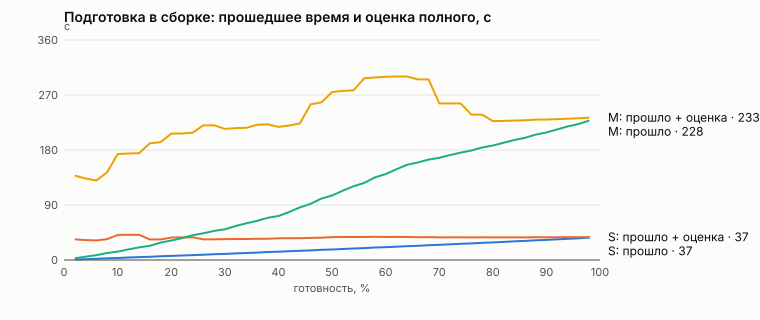
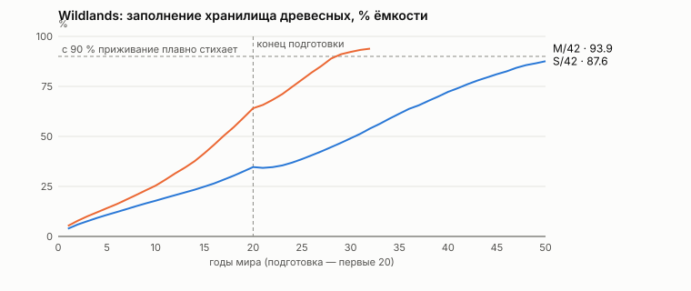
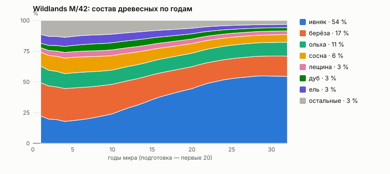
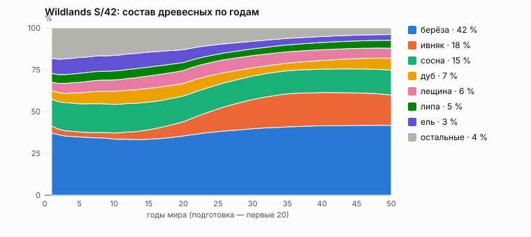

# WORLDBOUND — Unity Stage 2.5: колонизация, Genesis, Wildlands и подготовка

Дата: 2026-11-27 · Ветка: `experiment/unity-windows-prototype` · Эталон TS: `7b2fbabbc189f33a3181c7dbc72e54cd3aa8a65b` · Результаты: `docs/unity-stage2-5/`

> В задании хеш эталона записан без последнего символа (`…3aa8a65`); перенос сверялся с полным снимком `…3aa8a65b` — тем же, что на этапах 2.1–2.4.

Флора перенесена на C# **целиком**. Добавлены:
- колонизация через сухопутные края мира;
- семена региона во время подготовки Wildlands;
- приход колонистов обычными путями банка семян и приживания;
- подготовка Wildlands за 20 игровых лет — пакетами в бюджете кадра на главном потоке, с прогрессом, оценкой времени и отменой.

Защита от неперенесённых ветвей снята полностью: ведутся Genesis и Wildlands, с изоляцией и без.

**Результат.** Все сценарии G3 D–F совпадают с настоящим TS `Simulation.stateHash()` **побитно** — каждые сутки, а для открытого Genesis и Wildlands S/42 ещё и после каждой порции первых суток:
- D — открытый Genesis: колонизация, непригодная территория, детерминизм, болото у реки, исходные тесты о берёзе и сосне;
- E — Wildlands S/42: 20 лет подготовки и 5 лет развития;
- F — изолированный Wildlands S/42: 20 лет подготовки и 3 года после;
- Wildlands S/7 в холодном и S/1234 в тёплом климате, M/42;
- исходные тесты TS о Wildlands.

Совпадение подтверждено в .NET 6, редакторе Unity и QA-сборке Windows — на управляемой воде и на воде Burst. Регрессия G0–G3 C чистая.

Секция `FLOR`, Burst и многопоточность для флоры, рендер растительности, фауна и инструменты создателя не делались — по условию этапа.

## 1. Что перенесено

| C# | TS (`src/sim/flora/system.ts`) | Содержание |
|---|---|---|
| `FloraSystem.ColonizeEdge` | `colonizeEdge` | Позиции края `час + 24·часть` с шагом 144 из `4n`. Стороны с морем пропускаются. Для каждого вида с весом колониста > 0: точка на краю, дальность `min(max, 3·mean·u²) + 0,5` вглубь, поперечный сдвиг. Травы — в сезон семян и не в холод (`dayT ≥ 2`), 0,4 г/м²·вес·пригодность·доля сезона. Древесные — в свой день рассева, пакет с вероятностью 0,25·вес·пригодность (семена кроны 2 м² × плодовитость). Счётчиковый генератор, система 314 |
| `FloraSystem.RegionalSeedRain` | `regionalSeedRain` | В каждой ячейке суши во время подготовки, после почвы: травы — 0,15 г/м²·вес·пригодность·доля сезона; древесные — пакет с вероятностью 1·вес·пригодность в свой день рассева, точка в ячейке случайна. Система 315 |
| `AddColonistHerbSeeds`, `AddColonistWoodyPacket`, `NoteColonist` | одноимённые | Банк семян / `LandWoodyPacket` — обычные пути прорастания и приживания. Приток вещества — в `Ledger.External`. Масса и первое появление колонистов по видам |
| `ColonistSuit`, `WoodySeedDay` | `colonistSuit`, `woodySeedDay` | Пригодность места: климат сезона роста, климатическая влага, питание, почва; день рассева со сдвигом 0–3 суток |
| `Simulation.AdvancePreparation(maxTicks)`, `PreparationYear()` | `advancePreparation` | Не больше `maxTicks` тактов и не дальше конца подготовки; `FinishPreparation` — на такте `TargetTick`, как в TS |
| `FloraSystem.Unsupported` | — | Возвращает `null`: защита больше не нужна, все сценарии ведутся |
| `SimHost`: `Preparing`, `Cancelled`, `AdvancePreparation(budgetMs)`, `CancelPreparation` | `prepare()` в `sim.worker.ts` | Подготовка тем же ядром (ускоритель воды подключается до неё), пакеты по одной порции флоры (50 тактов) до исчерпания бюджета кадра; прогресс, год, растения, прошедшее и оставшееся время |
| `YearlyCostEta` (`Sim/Core/Eta.cs`) | `src/shared/eta.ts` | Оценка оставшегося времени по цене прожитых лет (тренд последних 6 лет, рост не больше 3 % в год) |
| `WorldApp` | — | Экран подготовки (год из 20, %, растения, прошло, осталось, Esc — отмена); N — сценарий следующего мира; режим замера `-wbprepbench` |

**Порядок** — как в TS:
- семена региона идут в каждой ячейке после почвы, до покрова и биома;
- колонизация через край — после цикла древесных;
- граница цикла древесных `HighWater` фиксируется в его начале, то есть после ячеек порции. Поэтому всходы от семян региона, появившиеся в ячейках, обрабатываются в той же порции, а всходы от семян растений и колонистов края — нет.

Прежние формулировки «граница на начало порции» в комментариях исправлены. До этапа 2.5 они не расходились с поведением: семян региона ещё не было.

**Изоляция** — как в TS (`populateWildlands`, раздел 16.1 плана фазы 3):
- **Genesis + изоляция** — внешних семян нет, мир пуст (тест B `flora-worlds`; G3 A);
- **Genesis без изоляции** — колонисты приходят через сухопутные края (сценарии D);
- **Wildlands + изоляция** — во время подготовки мир открыт региону *и* краям, как в TS, независимо от настройки. Изоляция действует с момента, когда мир готов. Флора изолированного и открытого Wildlands к концу подготовки совпадает побитно, а после подготовки изолированный мир не получает ничего.

Задание (п. 6.3) описывает изолированный Wildlands как «подготовку без внешней колонизации». Это не совпадает с TS: там во время подготовки идёт и колонизация через край. По требованию «сохрани поведение исходной TypeScript-версии» сохранена семантика TS. Её проверяют исходный тест «подготовка у изолированного и открытого мира одинакова» и сравнение E/F (раздел 3.3). Если нужна иная семантика — это изменение модели, отдельное решение.

## 2. Подготовка Wildlands в приложении

- Подготовка идёт на главном потоке: каждый кадр `SimHost.AdvancePreparation(40 мс)` выполняет порции по 50 тактов, пока не истечёт бюджет. Отдельного потока и упрощённой симуляции нет — это обычные такты `Simulation.Step`. Вода идёт на Burst, если он включён.
- Экран показывает: сценарий и seed, год подготовки из 20, долю готовности, число деревьев и кустарников, прошедшее время, оценку оставшегося (`YearlyCostEta`, как в TS). Esc — отменить.
- **Отмена** отбрасывает мир целиком: недоготовленный мир не сохраняется, как в TS. Хост переходит в состояние «отменено», G создаёт новый мир.
- **Повторный запуск** начинает подготовку с начала. Проверено: подготовленный мир тот же, что при подготовке без отмены (разделы 3.3 и 5).
- Результат не зависит от размера пакетов: подготовка пакетами по 7200, 5000 и 50 тактов даёт один хеш (раздел 3.3).

**Замер в QA-сборке** (`-wbprepbench`, хост как у игрока, бюджет подготовки 40 мс в кадре, Wildlands seed 42). Для S — запуск, отмена на 5 %, повторный запуск до конца; для M — до конца. Хеш готового мира сравнивается с эталоном TS (конец подготовки E-S42 и W-M42).

| Сборка QA, вода | Мир | Генерация, с | Подготовка (настенное время), с | Чистый счёт, с | Тактов | Кадров | Кадр p50 / p95 / p99 / макс., мс | Древесных | Хеш = TS | Отмена |
|---|---|---:|---:|---:|---:|---:|---|---:|---|---|
| Burst | S/42 | 0,6 | 37,3 (0:37) | 37,0 | 2 880 000 | 914 | 40,4 / 41,7 / 42,8 / 45,6 | 90 884 | ✔ | на 5,0 % через 1,5 с, 0,84 мс — OK |
| Burst | M/42 | 2,2 | 232,7 (3:52) | 231,1 | 2 880 000 | 5247 | 42,6 / 51,8 / 68,7 / 101,0 | 671 950 | ✔ | — |
| Mono | S/42 | 0,6 | 72,2 (1:12) | 71,7 | 2 880 000 | 1708 | 41,7 / 45,2 / 48,0 / 54,0 | 90 884 | ✔ | на 5,0 % через 2,9 с, 0,15 мс — OK |
| Mono | M/42 | 2,7 | 537,6 (8:57) | 534,2 | 2 880 000 | 8914 | 57,8 / 83,8 / 120,5 / 156,1 | 671 950 | ✔ | — |

Для сравнения TS (Node, без хоста, такты подряд): S — 53,1 с, M — 252,8 с.

Подготовка идёт пакетами в бюджете 40 мс, поэтому окно остаётся отзывчивым. В пакетном режиме без рендера кадры идут подряд, и настенное время почти равно чистому счёту.

Кадр может превысить бюджет: пакет — целая порция флоры (50 тактов), и раз в игровые сутки в ней пересчитывается полог всех растений. На M к концу подготовки это 670 тыс. растений, поэтому кадр p99 на Mono — 120 мс, максимум — 156 мс; с водой на Burst — 69 и 101 мс. Разнесение пересчёта полога — этап 2.7.

**Оценка оставшегося времени** (`YearlyCostEta`, как в TS) против фактического остатка:

| Сборка, вода | Мир | Оценка на 10 % | на 25 % | на 50 % | на 75 % | на 90 % |
|---|---|---|---|---|---|---|
| Burst | S | 0:37 при факт. 0:34 (11 %) | 0:25 при факт. 0:28 (-13 %) | 0:20 при факт. 0:20 (1 %) | 0:09 при факт. 0:10 (-4 %) | 0:04 при факт. 0:04 (-4 %) |
| Burst | M | 2:39 при факт. 3:39 (-27 %) | 2:56 при факт. 3:08 (-6 %) | 2:49 при факт. 2:07 (33 %) | 0:58 при факт. 0:53 (10 %) | 0:21 при факт. 0:23 (-12 %) |
| Mono | S | 1:10 при факт. 1:06 (6 %) | 0:46 при факт. 0:56 (-18 %) | 0:38 при факт. 0:40 (-6 %) | 0:20 при факт. 0:20 (-0 %) | 0:07 при факт. 0:09 (-19 %) |
| Mono | M | 9:29 при факт. 8:08 (16 %) | 4:44 при факт. 7:08 (-34 %) | 3:53 при факт. 5:42 (-32 %) | 2:56 при факт. 2:56 (0 %) | 1:18 при факт. 1:14 (6 %) |

## 3. Результаты G3 D–F

Эталон: `tools/unity-flora-g3d-golden.ts` → `Golden/flora-g3d.json` (настоящий TS `Simulation`, Node v24.22.1). Сводки и сравнение — общие с G3 C:
- каждые сутки — хеш, ведомость, хранилище, состояние подготовки, водные итоги;
- раз в год — полная сводка: виды, стадии, покров, колонисты по видам, наибольшие возраст и биомасса, `preparedYears`, `regionalSeedRain`, FNV 28 массивов, демография;
- выборки зон.

### 3.1. D — Genesis без изоляции (колонизация)

| Тест TS (`flora-worlds`) | Критерий | seed 1 | seed 2 | seed 3 |
|---|---|---|---|---|
| A: пустой мир заселяется извне | в начале — ни растений, ни семян, всё голая земля | ✔ | ✔ | ✔ |
| | год 1: приток > 0; банк у сухопутного края > 3 × в середине | 0,295 / 0,0096 г/м² ✔ | 0,300 / 0,0095 ✔ | 0,285 / 0,0093 ✔ |
| | занятость трав по годам 3/5/7/9: сначала < 60 %, не падает, к 9-му > 60 % | 9,9 / 21 / 48 / 93 % ✔ | 10,5 / 23 / 52 / 94 % ✔ | 10,1 / 20 / 39 / 84 % ✔ |
| | ≥ 10 видов-колонистов, древесные есть, ни одно не старше 9 лет, голой земли < 50 %, баланс | 18 видов, 67 древесных ✔ | 18, 80 ✔ | 18, 86 ✔ |
| D: непригодная территория (восток — камень, 120 мм) | запад занят > 50 %, восток — 0, древесных на востоке нет | 99,2 % / 0 ✔ | 99,7 % / 0 ✔ | 98,4 % / 0 ✔ |
| F: детерминизм колонизации | seed 1 дважды — тот же хеш и те же первые появления видов; seed 101 — другой | ✔ (C# повторяет прогон) | | |
| Болото у реки (seed 6, 10 лет) | болото есть, река — 4 × 32 ячейки | 169 ячеек болота, река 128 ✔ | | |
| `flora-dynamics`: берёза (открытый Genesis, как в исходном тесте) | листва летом > 0,9, зимой < 0,1, к 4-му лету масса × 3, опад | ✔ | | |
| `flora-dynamics`: сосна с хвоей зимой | листва = 1 | ✔ | | |

Берёза и сосна на этапе 2.4 проверялись в изолированном варианте. Теперь они проверены и в исходном виде, на открытом мире.

### 3.2. E, F и другие миры Wildlands

| Мир | Подготовка TS, с | Древесных к концу подготовки | Заполнение хранилища | Древесных видов | Приток за подготовку, кг элемента | Приток после | Баланс (макс.) | Хеш конца подготовки | Хеш конца прогона |
|---|---:|---:|---:|---:|---:|---|---:|---|---|
| E: S/42, умеренный | 53,1 | 90 884 | 34,7 % | 10 | 360,6 | 0,258 кг за 5 г. | 8.4e-07 | `754b858a7ff1cca7` | `77ca5ac058191787` |
| F: S/42, умеренный, изоляция | 53,3 | 90 884 | 34,7 % | 10 | 360,6 | 0,000 кг за 3 г. | 5.5e-07 | `790d3c7123e0ca9a` | `12d08dfce2f47c57` |
| S/7, холодный | 42,7 | 31 975 | 12,2 % | 10 | 210,8 | 0,053 кг за 1 г. | 4.9e-08 | `3aca297c138562c3` | `b484b578902a1351` |
| S/1234, тёплый | 65,3 | 142 224 | 54,3 % | 10 | 360,2 | 0,118 кг за 1 г. | 2.0e-08 | `df256e5f331582c0` | `0cc487b9fdbb7bb4` |
| M/42, умеренный | 252,8 | 671 950 | 64,1 % | 10 | 1 780,1 | 0,141 кг за 1 г. | 1.6e-07 | `8358591264894616` | `f20e5105f525f928` |

Время подготовки TS — Node v24.22.1 на той же машине. Это ориентир: в прежнем плане стояло 74–114 с для S и 6–7,5 мин для M, а здесь получилось 43–65 с и 4,2 мин.

Каждые сутки всех прогонов совпадают побитно. Для E — ещё и после каждой порции первых суток. Состояние подготовки (идёт или завершена) совпадает в каждой точке сравнения. `preparedYears = 20` и `regionalSeedRain = false` — с такта окончания подготовки.

Биомы суши к концу подготовки:

| Мир | Биомы |
|---|---|
| E: S/42, умеренный | луг 85 %, редкотравье 10 %, редколесье 4 %, голая земля 1 % |
| F: S/42, умеренный, изоляция | луг 85 %, редкотравье 10 %, редколесье 4 %, голая земля 1 % |
| S/7, холодный | луг 69 %, редкотравье 20 %, голая земля 6 %, тундра 4 %, пионерные 1 % |
| S/1234, тёплый | луг 54 %, редколесье 17 %, голая земля 14 %, редкотравье 9 %, болото 4 %, кустарники 2 % |
| M/42, умеренный | луг 82 %, редкотравье 9 %, редколесье 3 %, кустарники 3 %, болото 2 %, голая земля 1 % |

Холодный климат даёт тундру, тёплый — болота и больше редколесья. Умеренный S — в основном луг, с редколесьем по пригодным местам. Изолированный F к концу подготовки совпадает с E по флоре; хеши различаются только настройкой `isolated`, которая входит в хеш.

### 3.3. Подготовка, изоляция и детерминизм

| Проверка | Итог |
|---|---|
| Тест H (`flora-worlds`, участок 48 × 48 с рекой и сухим востоком, seed 1–3, 20 лет): занято травами > 80 %, есть всходы, подрост и взрослые, ≥ 5 древесных видов, ни одно растение не старше 20 лет, биомасса > 10 кг, ≥ 3 сухопутных биома, баланс | ✔ для всех seed: 4631–4688 древесных, 10 видов, старше 19,55 лет нет, до 60 кг; биомы — луг, степь, редколесье, кустарники |
| «Изолированный Wildlands» (32 × 32, seed 1–2): флора изолированного и открытого мира после подготовки одинакова (травы, банк, древесные, приток, колонисты); у изолированного приток > 0 | ✔ |
| «Изолированный Wildlands», 6 лет подготовки + 3 года: притока после подготовки нет, масса и первые появления колонистов не меняются, новых видов нет, растения мира размножаются, баланс | ✔ |
| E/F (S/42): флора к концу подготовки совпадает; после подготовки F не получает ничего, E продолжает получать колонистов через края | ✔: приток после подготовки F — 0, E — 258 г за 5 лет |
| Подготовка пакетами по 7200, 5000 и 50 тактов — один и тот же мир | ✔ |
| Подготовка, прерванная на 3000 тактах, и новый запуск с начала — тот же мир | ✔ |

### 3.4. Чувствительность эталона
Проверено подменами в C# с возвратом (`g3d A-1,isoW-1,H-1`).

| Подмена | Результат |
|---|---|
| Колонизация: без `+ 0,5` к дальности | Расхождение с 6-х суток A-1 (сезон семян): приток, хеш |
| Колонисты приходят и с морского края | Расхождение с 6-х суток A-1 |
| Семена региона: другой такт генератора (`день·4 + 1`) | Расхождение с 10-х суток H-1 |
| Первое появление колониста записано на такт позже | Расхождение с 6-х суток A-1 (`colonistFirst` в хеше) |
| Порог пакета колонистов `>=` → `>` | **Не обнаруживается**: случайное число, ровно равное порогу, не встречается; подмена эквивалентна на этих данных |

## 4. Хранилище древесных в настоящем Wildlands (вопрос заказчика)

Ёмкость и ограничения не менялись. Замер — `tools/wildlands-store-measure.ts` → `docs/unity-stage2-5/wildlands-store-ts.json`: Wildlands S/42 и M/42 (умеренный климат), 20 лет подготовки, затем мир живёт дальше; в конце каждого года записываются:
- число древесных, `HighWater`, свободные индексы;
- доля ёмкости и множитель приживания у предела (`storeRoom`);
- состав видов и стадий, рождения и гибели за год.

Это замер модели TS. C# совпадает с ней побитно на всём проверенном отрезке: 20 лет подготовки и год (M) или 5 лет (S) после.

| Год мира | M: древесных | M: заполнение | M: `storeRoom` | M: рождения / гибели за год | M: первые виды | S: древесных | S: заполнение | S: первые виды |
|---:|---:|---:|---:|---:|---|---:|---:|---|
| 5 | 148 006 | 14,1 % | 1,00 | 47 980 / 26 650 | берёза 27 %, ивняк 18 %, сосна 13 % | 28 299 | 10,8 % | берёза 35 %, сосна 17 %, шиповник 11 % |
| 10 | 266 246 | 25,4 % | 1,00 | 56 300 / 32 286 | берёза 24 %, ивняк 24 %, сосна 12 % | 46 803 | 17,9 % | берёза 34 %, сосна 17 %, шиповник 10 % |
| 15 | 436 213 | 41,6 % | 1,00 | 85 508 / 43 751 | ивняк 36 %, берёза 20 %, ольха 11 % | 65 341 | 24,9 % | берёза 33 %, сосна 17 %, ель 9 % |
| 20 (конец подготовки) | 671 950 | 64,1 % | 1,00 | 117 049 / 66 686 | ивняк 44 %, берёза 18 %, ольха 11 % | 90 884 | 34,7 % | берёза 35 %, сосна 15 %, ивняк 9 % |
| 22 | 715 678 | 68,3 % | 1,00 | 93 848 / 67 396 | ивняк 49 %, берёза 17 %, ольха 11 % | 90 787 | 34,6 % | берёза 37 %, сосна 15 %, ивняк 11 % |
| 25 | 821 348 | 78,3 % | 1,00 | 109 686 / 72 335 | ивняк 53 %, берёза 16 %, ольха 11 % | 101 239 | 38,6 % | берёза 38 %, сосна 14 %, ивняк 14 % |
| 28 | 932 290 | 88,9 % | 1,00 | 122 231 / 83 048 | ивняк 55 %, берёза 16 %, ольха 11 % | 117 029 | 44,6 % | берёза 39 %, ивняк 16 %, сосна 14 % |
| 30 | 967 260 | 92,2 % | 0,78 | 97 464 / 84 656 | ивняк 55 %, берёза 16 %, ольха 11 % | 128 569 | 49,0 % | берёза 40 %, ивняк 17 %, сосна 14 % |
| 32 | 984 418 | 93,9 % | 0,61 | 84 964 / 78 088 | ивняк 54 %, берёза 17 %, ольха 11 % | 141 403 | 53,9 % | берёза 40 %, ивняк 18 %, сосна 14 % |
| 35 | — | — | — | — | — | 160 841 | 61,4 % | берёза 41 %, ивняк 20 %, сосна 14 % |
| 40 | — | — | — | — | — | 189 515 | 72,3 % | берёза 41 %, ивняк 20 %, сосна 14 % |
| 45 | — | — | — | — | — | 212 599 | 81,1 % | берёза 42 %, ивняк 19 %, сосна 14 % |
| 50 | — | — | — | — | — | 229 558 | 87,6 % | берёза 42 %, ивняк 18 %, сосна 15 % |

Ёмкость: S — 262 144, M — 1 048 576 (4 растения на ячейку в среднем, не больше 2²⁰). Свободных индексов в стеке — 2–3 % от `HighWater`: гибель освобождает их, всходы занимают снова.

**Мир M:**
- к концу подготовки заполнен на 64 %, дальше растёт на 3–5 п.п. в год;
- 90 % — на 29-м году мира (9-м после подготовки), и приживание начинает стихать: `storeRoom` 0,78 на 30-м году, 0,61 на 32-м;
- рождения падают со 122 тыс. (28-й год) до 85 тыс. (32-й), прирост числа растений — с +35 тыс. в год до +8 тыс.

**Мир S:** на 50-м году заполнен на 88 %, предел ещё не достигнут.

Состав в M к пределу: ивняк 54–55 %, берёза 16–17 %, ольха 11 %. В S: берёза 42 %, ивняк 18 %, сосна 15 %.

**Ответ: да, в мире M ёмкость ограничивает естественное развитие** — примерно через 8–9 лет после подготовки. Рост числа растений почти останавливается, и сдерживают его не условия, а предел хранилища. Больше половины растений к этому времени — ивняк.

В мире S при умеренном климате предел достигается позже 50-го года. В тёплом климате S заполнен на 54 % уже к концу подготовки — ближе к пределу, чем умеренный.

Изменение ёмкости или предела — решение по модели, требующее согласования. Здесь ничего не менялось.

## 5. Производительность

**Подготовка Wildlands, 20 лет** (такты `Simulation.Step` подряд, без хоста; время только тактов подготовки):

| Мир (20 лет подготовки) | TS (Node 24) | .NET 6 | Редактор (Mono) | Сборка, Mono | Сборка, вода Burst |
|---|---:|---:|---:|---:|---:|
| S/42 умеренный, подготовка, с | 53,1 | 65,5 | 76,1 | 75,0 | 101,5 |
| S/42 изоляция, подготовка, с | 53,3 | 64,4 | 77,1 | 71,5 | 102,0 |
| S/7 холодный, подготовка, с | 42,7 | 48,5 | 64,5 | 61,9 | 80,3 |
| S/1234 тёплый, подготовка, с | 65,3 | 85,3 | 86,9 | 84,7 | 66,4 |
| M/42 умеренный, подготовка, с | 252,8 | 220,4 | 334,1 | 372,6 | 240,2 |

Ориентиры исходного плана для TS — S 74–114 с, M 6–7,5 мин — сравнительные, а не требования к Mono. На этой машине TS укладывается в 43–65 с (S) и 4,2 мин (M).

Эти времена сняты внутри пакета golden-проверок: многочасовой прогон на ноутбуке, где скорость зависит от нагрева и режима питания. Пример: S/42 с водой на Burst в пакете — 101,5 с, а в отдельном замере через хост (раздел 2) — 37,3 с; на Mono соответственно 75,0 и 72,2 с. Для скорости подготовки ориентир — отдельный замер:

| Подготовка 20 лет | TS (Node) | Сборка, вода Mono | Сборка, вода Burst |
|---|---:|---:|---:|
| S/42 | 53 с | 72 с | 37 с |
| M/42 | 4 мин 13 с | 8 мин 58 с | 3 мин 53 с |

Флора в сборке идёт на Mono; Burst ускоряет только воду. Burst для флоры — этап 2.7.

**Мир после подготовки:**

| Мир после подготовки | TS (Node 24) | .NET 6 | Редактор (Mono) | Сборка, Mono | Сборка, вода Burst |
|---|---|---|---|---|---|
| S/42: порция, мс (среднее / p99 / макс.) | 0,55 / 1,68 / 12,4 | 0,49 / 1,45 / 8,8 | 0,59 / 1,69 / 7,7 | 0,58 / 1,70 / 21,6 | 1,35 / 3,27 / 14,6 |
| M/42: порция, мс (среднее / p99 / макс.) | 2,71 / 7,80 / 39,9 | 1,93 / 7,12 / 54,6 | 2,85 / 9,29 / 40,4 | 3,55 / 14,92 / 167,7 | 3,21 / 9,90 / 57,0 |

**Разбивка флоры по частям**, M/42, весь прогон (`FloraProfile`):

| Часть, с за весь прогон M/42 (20 лет подготовки + год) | .NET 6 | Редактор (Mono) | Сборка, Mono | Сборка, вода Burst |
|---|---:|---:|---:|---:|
| Пересчёт полога | 4,4 | 6,2 | 10,2 | 6,5 |
| Цикл древесных | 40,0 | 52,4 | 77,0 | 54,5 |
|   в нём: семена и расселение | 4,8 | 6,1 | 9,3 | 5,8 |
|   в нём: приживание | 2,7 | 3,3 | 5,3 | 3,1 |
|   в нём: смерть | 0,2 | 0,2 | 0,3 | 0,2 |
| Колонизация через край | 0,2 | 0,3 | 0,4 | 0,4 |
| Семена региона | 11,9 | 16,9 | 18,4 | 20,8 |
| Травы, проходы 1–2 | 12,9 | 20,0 | 21,7 | 23,2 |
| Семена трав | 6,9 | 11,1 | 12,5 | 12,6 |
| Прорастание | 6,6 | 9,8 | 11,3 | 11,7 |
| Старение банка | 10,9 | 15,7 | 19,0 | 18,3 |
| Почва | 5,6 | 7,5 | 8,2 | 8,9 |
| Покров и биом | 24,5 | 43,6 | 47,8 | 51,7 |

Сборок мусора поколения 0, попавших на шаги ядра, — .NET 6: E-S42 — 0, W-M42 — 1; Редактор (Mono): E-S42 — 0, W-M42 — 0; Сборка, Mono: E-S42 — 0, W-M42 — 0; Сборка, вода Burst: E-S42 — 0, W-M42 — 1. Выделения внутри шагов (.NET, M/42) — 0 байт, поэтому единичную сборку запускают выделения самой проверки между шагами, а завершается она на шаге.

Машина: Intel Core i5-1235U, 12 потоков, 7,9 ГБ; Windows 11; Unity 6000.3.29f1. Каждое значение — один прогон, без повторов: это измерения, а не оценки, но разброс между прогонами — десятки процентов.

## 6. Регрессия и проверки

G3 D–F, проверок / расхождений:

| Часть G3 D–F | .NET 6 | Редактор (Mono) | Сборка, Mono | Сборка, вода Burst |
|---|---:|---:|---:|---:|
| G3 D–F побитно с TS | 131147 / 0 | 131147 / 0 | 131147 / 0 | 131147 / 0 |
| баланс вещества по суткам (≤ 1e-4) | 5480 / 0 | 5480 / 0 | 5480 / 0 | 5480 / 0 |
| WoodyStore: целостность | 3260 / 0 | 3260 / 0 | 3260 / 0 | 3260 / 0 |
| счётчики ячеек ≤ 12 | 3240 / 0 | 3240 / 0 | 3240 / 0 | 3240 / 0 |
| смерть и повторное использование индексов | 469470 / 0 | 469470 / 0 | 469470 / 0 | 469470 / 0 |
| листва ±0,35 в сутки, хвоя | 3260 / 0 | 3260 / 0 | 3260 / 0 | 3260 / 0 |
| исходные тесты TS: колонизация и Wildlands | 22 / 0 | 22 / 0 | 22 / 0 | 22 / 0 |
| подготовка: пакеты, повтор, изоляция | 9 / 0 | 9 / 0 | 9 / 0 | 9 / 0 |
| **Всего (проверок / расхождений)** | **615888 / 0** | **615888 / 0** | **615888 / 0** | **615888 / 0** |

**Регрессия предыдущих этапов** (на окончательном коде Stage 2.5):

| Проверка | .NET 6 | Редактор | Сборка QA |
|---|---|---|---|
| Генератор, среда (Mono и Burst), сохранение S/M, устойчивость WBSV, темп и пауза, хост | OK | OK | OK |
| G0/G1 (55 148), `WoodyRestoreCheck`, G2 (956) | OK | OK | OK |
| G3 A, голая земля (25 239) | OK | OK | OK (вода Burst полностью; вода Mono — 25 суток) |
| G3 B, травы (752 919) | OK | OK | OK (вода Burst полностью; вода Mono — 40 суток) |
| G3 C, древесные (1 108 042) | OK | OK | OK (вода Mono и Burst полностью) |
| **G3 D–F** | OK | OK | OK (вода Mono и Burst полностью) |

Часть «защита» G3 B обновлена: открытый Genesis и Wildlands теперь ведутся (`Unsupported` = `null`), а мир с травами и деревом ведётся сутки без остановки.

Сборки:
- QA и Release собраны без ошибок; в Release нет тестовой сборки (`build-contents-release.json`), `-wbsimtest` там завершается с кодом 2;
- вода и погода не менялись, TS-исходники эталона не менялись;
- TS-инструменты (`unity-flora-g3d-golden.ts`, `wildlands-store-measure.ts`) проходят `tsc` и `eslint`.

## 7. Известные ограничения

1. **Сохранение не содержит флору** (`FLOR` — этап 2.6). Исходные тесты G (сохранение и загрузка Wildlands и Genesis) не перенесены. В приложении сохранение Wildlands во время подготовки невозможно: автосохранение и F5 работают только в готовом мире, как в TS. Но готовый мир после загрузки теряет флору — так же, как с этапа 2.2.
2. **Ёмкость хранилища ограничивает развитие мира M** через ~9 лет после подготовки (раздел 4) — вопрос заказчику.
3. **Семантика изолированного Wildlands** — как в TS: во время подготовки мир открыт и краям (раздел 1). Формулировка задания п. 6.3 с ней расходится.
4. **Подготовка M в сборке** занимает минуты (раздел 5). Burst и разнесение пересчёта полога — этап 2.7.
5. **Приложение по умолчанию создаёт Genesis с изоляцией**, как с этапа 2.2. Wildlands — по `-wbscenario wild` или клавише N (сценарий следующего мира) и G.
6. Исходные тесты `flora-worlds` E (биом следует за растительностью: вырубка, засуха через изменение `landMeanPrecip`) и порог мигания биома в эталоны G3 не вошли. Механика, которую они проверяют (биомы, гибель древесных, колонизация), сверяется побитно в C2 и D–F.

## 8. Коммиты

Ветка `experiment/unity-windows-prototype`; `main` не изменялся, ветки не объединялись, история не переписывалась.

| Коммит | Содержание |
|---|---|
| [`87a7746`](https://github.com/ashkerov/worldbound/commit/87a7746) | Колонизация через край, семена региона, приход колонистов; `AdvancePreparation`; `YearlyCostEta`; защита снята |
| [`98ce46b`](https://github.com/ashkerov/worldbound/commit/98ce46b) | Эталон G3 D–F из настоящего TS и проверка C# (критерии исходных тестов, подготовка пакетами, повтор, изоляция) |
| [`40c63ac`](https://github.com/ashkerov/worldbound/commit/40c63ac) | Подготовка в `SimHost` и приложении: прогресс, оценка времени, отмена; режим `-wbprepbench`; G3 D–F в редакторе и сборке |
| коммит с этим отчётом | Отчёт, графики, результаты (`docs/unity-stage2-5/`), замер хранилища (`tools/wildlands-store-measure.ts`), обновление `PROJECT_CONTEXT.md`, `ARCHITECTURE.md`, `DEVELOPMENT_PLAN.md`, `docs/UNITY_MIGRATION_STAGE2_PLAN.md` |
